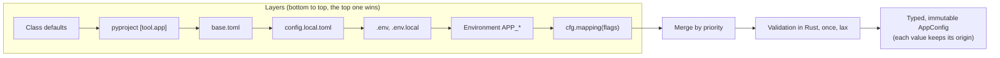
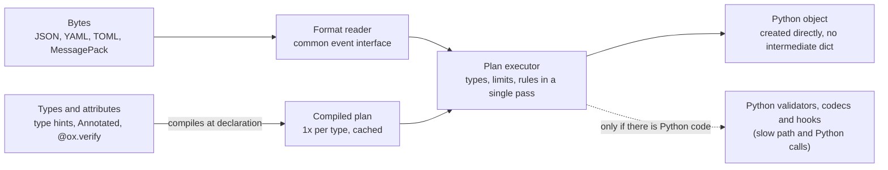
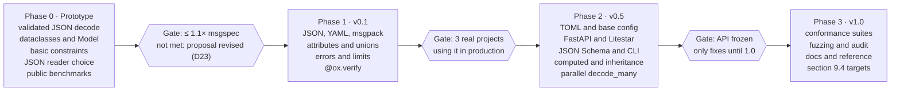

# oxiform — Specification 1.0

2026-10-28 · revised 2026-10-31

**oxiform** is a Python library with a Rust engine that validates and (de)serializes your types to JSON, YAML, TOML and MessagePack in a single pass, and loads layered configuration with the same model. This specification closes the open decisions of version 0.1 and defines what 1.0 must deliver.

## 1. Decisions made

D1–D13 close the 7 open questions from the review and 6 defaults that were implicit. D14–D22 come from the 2026-10-31 review, which resolved inconsistencies and fixed what was missing to start the implementation. D23 is the outcome of gate G1 at the end of phase 0. D24 and D25 come from the config slice (porto-309.14), D26 from the validation context (porto-309.15). The rest of the spec already applies them.

| # | Decision | Choice | Why |
| --- | --- | --- | --- |
| D1 | Name | **oxiform** (import: `import oxiform as ox`) | "oxi" (Rust, oxide) + "form" (shape of the data). Free on PyPI and crates.io on 2026-10-28; reserve both now |
| D2 | Ways to declare rules | Three: `Annotated`/`ox.field` (one field), `@ox.verify` (across fields), `@ox.validator` (Python) | Covers all cases without overlap. `@check` was absorbed by `validator`; string rules move to 1.x, only for rules that come from data |
| D3 | Does the constructor validate? | Only the top-level type of each field (`isinstance`, without walking collections). Constraints, rules and deep validation with `validate_init=True` | Building objects in code must be fast; external data enters through `decode`/`convert`, which validate everything |
| D4 | Security limits | On by default, with generous values (section 7) | Safe by default; whoever needs more raises the limit explicitly |
| D5 | `datetime` without timezone | `datetime` requires a timezone; `ox.NaiveDateTime` accepts one without a timezone | The intent is in the type, not in a global flag |
| D6 | YAML backend | saphyr for 1.0 (YAML 1.2); own round-trip layer in 1.x | Maintained and modern; round-trip needs a parser that keeps comments, so it comes later. To be confirmed in the prototype |
| D7 | Governance | License MIT OR Apache-2.0, GitHub organization, at least 2 maintainers with release rights | Standard in the Rust ecosystem; avoids depending on a single person |
| D8 | Supported Python | CPython 3.11–3.14, including free-threaded (3.13t+) | 3.10 reaches end of life in October 2026 |
| D9 | Unknown keys | `unknown="ignore"` in models; `"forbid"` in configs | In APIs, ignoring makes evolution easier; in a config, an unknown key is almost always a typo |
| D10 | Coercion | `strict` in JSON, YAML, TOML and msgpack; `lax` in `convert`, env, CLI and forms | Typed formats do not need to guess; text coming from env/forms does |
| D11 | `Decimal` in JSON | Writes as string; reads string or number | No loss of precision in JavaScript clients |
| D12 | Errors | Collects all, up to `max_errors=100`; `redact_inputs` on when `OXIFORM_ENV=production` | Good for APIs and forms; no data leaks in production |
| D13 | Scope | Small 1.0 (section 2); round-trip, migrations, Arrow, profiles and Rust plugins in 1.x | Reach 1.0 with quality; everything else comes in without breaking the API |
| D14 | Shape of configs | `@ox.config` implies `kw_only=True` and `frozen=True`; every nested model in a config is `@ox.config`; mutable collections are an error | A config is never built by position, so required and optional fields can come in any order. Sections inherit `unknown="forbid"` (a typo in `[server]` is also an error) and the config is immutable end to end, safe to share between threads |
| D15 | GIL and single pass | A decode is a single pass, always with the interpreter; parallelism comes from free-threading and `decode_many(threads=N)` | Releasing the GIL in the middle of a decode requires two passes and costs the speed that keeps oxiform close to msgspec (D23). The real parallelism gain is in batches |
| D16 | What counts as slow path | `strict_rules` forbids `@ox.validator` and lambdas that do not compile. `default_factory`, codecs and Python hooks are "Python calls", visible in `ox.explain` and always allowed; known factories run in Rust | A factory only runs when the field is missing and a Python codec is intentional; treating them as slow rules was noise and made `strict_rules` unusable |
| D17 | Unions | Resolved by wire type (at most one variant per type: object, array, string…) or by tag. Two variants with the same wire type and no tag are an error at import | O(1) choice with no ambiguity; trying in order is slow and surprising, so only with an explicit `ox.Untagged()` |
| D18 | Compiling Python code | Only the lambdas of `@ox.verify` are compiled, and only when the result is guaranteed to equal Python's. `@ox.validator` always runs in Python in 1.0 | Compiling function bodies is a separate project; the validator is the escape hatch and must behave exactly like Python |
| D19 | Paths in errors | Wire names (what the client sent), as a list and as a JSON Pointer | The error describes the input; JSON Pointer is what RFC 9457 and forms use |
| D20 | MessagePack | Only the official timestamp extension; `Decimal` as string; `int` outside 64 bits is an error | Interoperable with any msgpack lib; no value silently loses precision |
| D21 | Wheels | One wheel per Python version (no abi3) | The performance target needs the full C-API, and abi3 does not exist in free-threaded |
| D22 | Format readers | Own event interface (numbers as raw text, positions) and an own pull reader for JSON, chosen over sonic-rs in phase 0 | Serde does not preserve the text of numbers nor detect duplicate keys, and sonic-rs offers no pull interface: going through its DOM adds a tree that the single pass avoids. The interface is the stable contract; the backend is replaceable |
| D23 | Value proposition (gate G1) | Multi-format, validation and config, with JSON speed close to msgspec (at most 2×) and well ahead of pydantic (at least 2×), instead of "the fastest" | The phase 0 prototype decodes at 1.2–1.8× the time of msgspec and 2–4× faster than pydantic v2. Closing the rest needs a native model layout and a SIMD structural reader, which would delay every other feature; that work continues alongside the next phases |
| D24 | Names of the config API | `@ox.config` is the decorator and `oxiform.cfg` (`from oxiform import cfg`) is the namespace of `load`, the sources and `origin` | A module cannot be a typed dataclass transform, so `ox.config` has to be a function, and the same name cannot also be the module of the sources |
| D25 | `ox.Secret` and encoding | Encode always writes `"********"` for a secret, in every format, with no switch; the value leaves only through `.reveal()` | A secret that can be written by a flag is one typo from a log line. `ox.Policy(secrets="reveal")` joins when `ox.Policy` does |
| D26 | `@ox.validator`: where it runs and what it gets | After the type and constraints of its field only (no `mode="before"` in 1.0), in declaration order once the whole map is read; model validators after the instance exists. The context is any object, passed through as is and typed with `ox.Context[T]`; a missing context is a `TypeError` for the host and never a validation problem | The engine reads the input once, straight into the final types (D15), so there is no raw Python value for a "before" validator until `ox.convert` exists. Running in declaration order makes effects independent of key order, and a context that is passed as is costs nothing and lets Douro hand over its own request type |

## 2. Scope

1.0 covers the complete cycle of external data (read, validate, write) in four formats, plus layered config. Everything in the 1.x column is designed to come in without breaking the 1.0 API.

| Area | 1.0 | 1.x |
| --- | --- | --- |
| Types | `@ox.model`, `ox.Model`, dataclass, attrs, TypedDict, NamedTuple, inheritance, `@ox.computed`, generics | `ox.Subclasses[T]`, msgspec `Struct` shim |
| Formats | JSON (+ JSON Lines), YAML, TOML, MessagePack | CBOR, canonical JSON (RFC 8785), BSON |
| Validation | Constraints, `strict`/`lax`, `@ox.verify`, `@ox.validator`, context, `ox.Partial`, structured errors | Full i18n, string rules coming from data, compilation of `@ox.validator` |
| Attributes | rename, aliases, defaults, skip, flatten, 4 union modes, include/exclude, `unknown=` | `catch_all`, `array_like`, `groups` |
| Advanced | `iter_decode`, `decode_many`, `ox.Raw` (JSON and MessagePack), JSON Schema | `ox.Lazy`, `ox.View`, `ox.Raw` in YAML/TOML, YAML/TOML round-trip, version migrations, Arrow/Polars |
| Config | Class, files, `glob`, `.env`, env, secrets dir, priority, merge, origin per value, `Secret` | Profiles, interpolation, CLI, hot reload, remote sources |
| Security | Default limits, safe YAML, `redact_inputs` | — |
| Integrations | FastAPI, Litestar, pytest helpers | pydantic/msgspec shims, codemod, Hypothesis, Django |
| Tooling | `ox.explain`, `ox check`, `ox schema`, `ox config explain`, full stubs | `ox convert`, `ox diff`, `ox bench`, TypeScript codegen |
| Extension | Python codecs, `via=`, `__oxiform_*__` protocol | Rust plugins (formats and constraints) |
| Platforms | CPython 3.11–3.14 + free-threaded; Linux, macOS, Windows; x86-64 and ARM64 | PyPy, Pyodide/WASM |

Out of scope in any version: ORM, HTML form generation, asynchronous (I/O) validation inside the engine.

## 3. Models and types

There is one recommended way to declare models (`@ox.model`), one for maximum performance (`ox.Model`), and direct support for the types you already have. All three compile to the same plan in Rust.

### 3.1 Complete example

```python
from datetime import datetime
from decimal import Decimal
from typing import Annotated, Literal
import oxiform as ox
from oxiform import Ge, Le, Len, Pattern, Email

@ox.model(rename_all="camelCase")
class Address:
    street: str
    postal_code: Annotated[str, Pattern(r"^\d{4}-\d{3}$")]
    country: Literal["PT", "DE", "BR"] = "PT"

@ox.model(rename_all="camelCase")
class User:
    id: int
    name: Annotated[str, Len(1, 80)]
    email: Email
    age: Annotated[int, Ge(0), Le(150)] | None = None
    addresses: list[Address] = ox.field(default_factory=list)
    created_at: datetime = ox.field(default_factory=ox.now_utc)

user = ox.json.decode(raw_bytes, User)    # bytes -> validated User
ox.yaml.encode(user)                      # User -> YAML bytes
```

### 3.2 Three ways to declare

| Form | When to use | Example |
| --- | --- | --- |
| `@ox.model` | Default. Generates a dataclass-like class with slots | `@ox.model(frozen=True)` |
| `ox.Model` | Maximum speed and less memory (compact layout in C) | `class Point(ox.Model, frozen=True): ...` |
| Your own types | dataclass, attrs, TypedDict, NamedTuple, without touching the code | `ox.json.decode(raw, MyDataclass)` |

For types that are not yours, the configuration goes in a separate `Codec`:

```python
codec = ox.Codec(ThirdPartyOrder, rename_all="camelCase", unknown="forbid")
order = codec.json.decode(raw)
```

Options of `@ox.model` and `ox.Model`: `frozen`, `kw_only`, `order`, `eq`, `hash`, `rename_all`, `unknown`, `tag`, `tag_field`, `skip_if_default`, `skip_if_none`, `coerce`, `validate_init`, `validate_assignment`, `strict_rules` (signatures in section 11). All models support `pickle`, `copy`, `ox.replace()` (and `copy.replace()` in 3.13+) and `__match_args__`.

Declaration rules:

- **Field order:** a required field after a field with a default requires `kw_only=True`, as in dataclasses. `@ox.config` already implies it (D14).
- **Defaults** are validated and converted once, when the plan is compiled. An invalid default is a declaration error.
- **When it compiles:** the plan is compiled in the decorator. Forward refs to classes not yet defined are resolved on first use or in `ox.warmup()`. Types that are not yours are compiled on first use. Declaration errors raise `ox.SchemaError` at that moment.
- **Instance creation in decode:** oxiform does not call `__init__`, it fills the slots directly. If the type has `__post_init__` (models and dataclasses) or attrs validators and converters, they are called (Python calls, section 9.2).

### 3.3 Inheritance

Subclasses inherit fields, attributes, rules and options from the model (except `tag`, which belongs to each class). They can add fields and rules, but not remove fields.

```python
@ox.model(tag_field="kind")
class Animal:
    name: str

@ox.model(tag="dog")
class Dog(Animal):
    breed: str

@ox.model(tag="cat")
class Cat(Animal):
    indoor: bool

pet = ox.json.decode(b'{"kind": "dog", "name": "Rex", "breed": "lab"}', Dog | Cat)
```

- A union of models that all declare the same `tag_field` is resolved by that field, as if it were `ox.Tagged("kind")` (section 5.3).
- Encode always writes the tag. When reading a concrete type (`Dog`), the tag is optional, but if present it must be the right one (`tag` error).
- Without `tag`, the tag value is the class name with the model's `rename_all`.

### 3.4 Computed fields

```python
@ox.model
class Order:
    items: list[Item]

    @ox.computed
    def total(self) -> Decimal:       # appears in encode and JSON Schema; ignored in decode
        return sum((i.qty * i.price for i in self.items), Decimal(0))
```

- `@ox.computed(cache=True)` computes once per instance (only in `frozen` models).
- On read, the key of a computed field is ignored, even with `unknown="forbid"`, so that `decode(encode(x)) == x`.

### 3.5 Types supported on the fast path

| Category | Types |
| --- | --- |
| Scalars | `int` (no size limit), `float`, `bool`, `str`, `bytes`, `bytearray`, `None` |
| Numbers | `Decimal`, `Fraction` |
| Time | `datetime` (with timezone), `ox.NaiveDateTime`, `date`, `time`, `timedelta`, `ZoneInfo` |
| Identifiers | `UUID`, `ipaddress.*`, `Path`, `ox.Email`, `ox.Url`, `ox.HttpUrl` |
| Collections | `list`, `tuple` (fixed and variable), `set`, `frozenset`, `dict` (keys `str`, `int`, `UUID`, `date`, `Enum`), `Sequence`, `Mapping` |
| Algebraic | `Union`, `Optional`, `Literal`, `Enum`, `IntEnum`, `StrEnum`, `Flag` |
| Generics | `class Page[T]` (PEP 695), `TypeVar`, `NewType`, `type Alias = ...` |
| Structures | `@ox.model`, `ox.Model`, dataclass, attrs, `TypedDict` (with `Required`/`NotRequired`/`ReadOnly`), `NamedTuple` |
| Recursive | Self-referencing models, `type Tree = dict[str, Tree] \| int` |
| Special | `Any`, `ox.Raw` (fragment left to decode, JSON and MessagePack), `ox.Secret[T]` |

Representation:

- Models, dataclass, attrs and `TypedDict` map to objects; `tuple` and `NamedTuple` to arrays.
- On read, `Sequence` gives `list` and `Mapping` gives `dict`. In configs, `Mapping` gives a read-only mapping (section 6.1).
- `ox.Email`, `ox.Url` and `ox.HttpUrl` are aliases of `Annotated[str, ...]`: the value is still a `str`, as it was received.
- A specialized generic (`Page[User]`) has its own cached plan.

Types outside the list come in through codecs (section 8).

## 4. Validation

Validation runs during parsing, in the same pass in Rust. There are three ways to declare rules (D2), and all those that do not call Python code stay on the fast path.

### 4.1 Rules for one field: `Annotated` or `ox.field`

```python
Positive = Annotated[int, ox.Gt(0)]                   # reusable alias
Sku = Annotated[str, ox.Strip(), ox.Upper(), ox.Pattern(r"^[A-Z]{3}-\d{4}$")]

@ox.model
class Product:
    sku: Sku
    price: Annotated[Decimal, ox.Ge(0), ox.Digits(max=12, decimals=2)]
    stock: Positive
    tags: Annotated[list[str], ox.Len(max=10), ox.Unique()]
    rating: float = ox.field(ge=0, le=5, default=0.0)   # equivalent shortcut
```

| Family | Constraints |
| --- | --- |
| Number | `Ge`, `Gt`, `Le`, `Lt`, `MultipleOf`, `Digits(max, decimals)`, `Finite` |
| Text | `Len`, `Pattern`, `StartsWith`, `EndsWith`, `Contains`, `Ascii`, `NonBlank` |
| Transformations | `Strip`, `Lower`, `Upper`, `NormalizeUnicode(form)`, `Truncate(n)` |
| Collections | `Len`, `Unique`, `Each(*constraints)`, `Keys(*constraints)`, `Values(*constraints)` |
| Formats | `Hostname`, `IPv4`, `IPv6`, `Cidr`, `Iban`, `Semver`, `Slug`, `Base64`, `Hex` |
| Time | `Past`, `Future`, `After`, `Before` |
| General | `OneOf`, `NotIn`, `Const` |

- **Shortcuts in `ox.field`:** accepts the single-value constraints: `ge`, `gt`, `le`, `lt`, `multiple_of`, `min_len`, `max_len`, `pattern`. The others are declared with `Annotated`.
- **Transformations** run after the type and before the checks, in the order they appear.
- **Compatibility:** a constraint on a type where it makes no sense (`Strip` on an `int`, `Ge` on a `list`) is a declaration error.
- **`Pattern`** uses the `regex` crate, without backtracking. Lookaround and backreferences are a declaration error. It searches anywhere in the text (like `re.search` and the JSON Schema `pattern`); to match the whole text, anchor with `^…$`. A JSON Schema `pattern` is ECMA 262, so writing the schema of a constraint that has no such form (inline flags, `\p{..}` classes) is a declaration error (section 8.5).
- **`Unique`** requires hashable elements, checked at declaration.
- **Constraints are values.** Two constraints are equal when they are the same constraint with the same values *and the same value types*: `Ge(1)`, `Ge(1.0)` and `Ge(True)` are three different constraints, and `Ge(0.0)` differs from `Ge(-0.0)`. Plans are cached by type, and `typing` caches `Annotated[...]` aliases by the equality of their metadata, so a constraint that compared equal across types (`1 == True`) would hand back the alias, and the plan, of another declaration, hiding a declaration error such as `Ge(True)`. The same holds for oxiform's own cache keys, such as the values of a `Literal`.
- **`Past` and `Future`** compare against the clock read at the start of the decode.

### 4.2 Rules across fields: `@ox.verify`

Accepts constraints on a field (`ox.on`), lambdas, `ox.rule` and `ox.RuleSet`.

```python
DateRange = ox.RuleSet(
    ox.rule(lambda o: o.start <= o.end, path="end", message="end must be after start"),
    lambda o: (o.end - o.start).days <= 365,
)

@ox.model
@ox.verify(
    DateRange,
    ox.on("budget", ox.Ge(0)),
    lambda o: len(o.items) > 0 or o.status == "draft",
    ox.rule(lambda o: sum(i.qty * i.price for i in o.items) == o.total, path="total"),
)
class Order:
    start: date
    end: date
    status: Literal["draft", "confirmed"]
    budget: Decimal
    items: list[Item]
    total: Decimal

ox.verify(DateRange)(ThirdPartyBooking)     # also on types that are not yours
```

**Compilation (D18).** Lambdas are read once and compiled to Rust when they use this subset: comparisons, `and`/`or`/`not`, arithmetic, `len`, `sum`, `min`, `max`, `any`, `all`, `in`, attributes, indexes, generators over model collections and the attributes of `date`, `datetime` and `timedelta`. Compilation only happens if the result is guaranteed to equal Python's:

- **Free names** (globals or closure) only if they are immutable constants (`int`, `str`, `tuple`, `frozenset`…), read at compile time. Other names make the rule run in Python.
- **`Decimal`** uses the thread's decimal context. If the context is not the default, the rule runs in Python in that decode.
- **The source** is located with the code object positions (3.11+). Without available source (REPL, `exec`), the rule runs in Python.

**Execution:**

- A rule only runs if the fields it uses passed validation; otherwise it is skipped, because the field error already explains the problem.
- A rule without `path` reports the error at the model root.
- Field names given as strings are checked at declaration, with a suggestion in case of a typo.
- A lambda that does not compile runs in Python and shows up as slow path in `ox.explain`; with `strict_rules=True` it is a declaration error.
- The order between `@ox.model` and `@ox.verify` does not matter.

### 4.3 Logic in Python: `@ox.validator` and `ox.Context`

For what cannot be declared. Always runs in Python (D18). A validator is a function in the class body, marked with `@ox.validator`:

```python
@ox.model
class Signup:
    username: Annotated[str, ox.Len(3, 30)]
    password: str
    password2: str

    @ox.validator("username")                   # one field, after its type and constraints
    def not_reserved(cls, v: str) -> str:
        if v in RESERVED:
            raise ox.Invalid("reserved name", code="reserved")
        return v

    @ox.validator("username")                   # external data, through the context
    def same_tenant(cls, v: str, ctx: ox.Context[TenantContext]) -> str:
        if v.endswith("@" + ctx["tenant"]):
            return v
        raise ox.Invalid("not in your tenant")

    @ox.validator                               # the whole model, after everything
    def passwords_match(self) -> None:
        if self.password != self.password2:
            raise ox.Invalid("passwords do not match", path="password2")

ox.json.decode(raw, Signup, context={"tenant": tenant})
```

**Shapes.**

- `@ox.validator("a", "b")` is a *field validator* of those fields (each name is the Python name of a field of that class that the input gives; a name that is not one, or a field that is skipped on read, is an `ox.SchemaError`, with a suggestion for a typo). It is called `f(cls, value)` and **returns the value**, possibly replaced: the replacement is not read again, so it must already be a valid value of the field's type. A field validator that returns `None` for a field whose type does not accept `None` is a bug (a forgotten `return`), and is an `ox.SchemaError` at that decode, not a silent `None`. `cls` is the class being decoded (the subclass, for an inherited validator; the flattened class, for a field of a flattened model).
- Bare `@ox.validator` is a *model validator*, called `f(self)` on the finished instance and returning `None` (anything else is an `ox.SchemaError`). It runs on a frozen model too: it reads, it does not assign.
- A plain function and a `classmethod` object are both accepted for a field validator (`@ox.validator("x")` above or below `@classmethod`). `staticmethod`, `async def`, a generator and a lambda are `ox.SchemaError`s. `@ox.validator()` with no field and parentheses is an error too: write the names, or drop the parentheses for a model validator.
- `mode="after"` is the only mode in 1.0 (D26). `mode="before"` is an `ox.SchemaError` that says so: a "before" validator needs the raw value as a Python object, but a decode reads the input once, straight into the final types (D15); it arrives together with `ox.convert` (reading Python objects), which gives it a place to run.

**The context.** `context=` is an argument of every decode (`ox.json.decode`, `ox.json.Decoder.decode`, `ox.urlencoded.decode`, `ox.pairs.decode`, `cfg.load`, and the `context` of `OxDecodeOptions` and `OxPairsOptions` in the C ABI, section 9.5). It is **any object**: oxiform does not copy, wrap or inspect it, so Douro's `{"request": request}` arrives as the same dict and a host's own class arrives as that class. A validator receives it in the parameter annotated `ox.Context`:

- `ox.Context[T]` is `T` to a type checker (`ox.Context` alone is `Mapping[str, Any]`), so `ctx: ox.Context[TenantContext]` with a `TypedDict` is checked by pyright strict. At run time it is `Annotated[T, <marker>]`, and the marker is how oxiform finds the parameter, by annotation and never by name; a string annotation (`from __future__ import annotations`) is read the same way.
- The parameter is passed by keyword, so it may sit anywhere after the value. It is **required unless it has a default or its annotation is `ox.Context[T] | None`**: when the decode has no context, a validator that requires one fails with a `TypeError` that names the validator and says to pass `context=...` to the decode call, a validator whose parameter has a default is called without it (and uses its default), and one annotated `ox.Context[T] | None` with no default is given `None`. That error is raised when the validator would run, not before the decode, so a decode whose input is rejected earlier, or does not reach the field, never needs the context. It is never a validation error: a missing context is the host's mistake, not the client's.
- The context is **read-only by contract** (`Mapping` says so to the checker; nothing stops a validator that mutates a dict, and oxiform does not guard it). It is borrowed for the call and shared by every validator of that decode, on whatever thread decodes: on a free-threaded build the host owns its thread safety, as for any object it shares between threads.
- **Encode and the schema.** `encode` never runs validators (section 4.6: it only validates with `validate=True`, which is `ox.validate`), and a validator never changes what the JSON Schema says (section 8.5): it is code, and a schema describes the input a client may send. A model that has validators says what they check in its `description`, not in the schema.

**Errors.**

- `ox.Invalid(message, *, code="invalid", path=None)` becomes one problem with that `code` (the code `invalid` when none is given, section 11.2), `message`, and no `input` (the value is a Python object by then, not text, and an arbitrary `repr` is both slow and a leak). It subclasses `ValueError`. `path` is one segment (`"password2"`, `0`) or a sequence of them, relative to the value being validated; a first segment that is the Python name of a field of the model is written as its wire name (D19), the rest as given. `ValueError` and `TypeError` raised in a validator become the same problem with the code `invalid` and `str(error)` as message (a `ValueError` that carries no message, `ValueError()`, says `invalid value`). **Any other exception propagates unchanged** (a `KeyError` for a missing key of the context is a bug in the validator, and a `ZeroDivisionError` is not "invalid input"); so does the `TypeError` for a missing context, which oxiform raises itself, outside the validator's `try`.
- Where the problem is: a field validator's problem is at the field (`/username`, with `path` relative to it); a model validator's at the model (the empty pointer at the root, `/billing` for a nested model, with `path` relative to it, `path="password2"` giving `/billing/password2`). Every validator that runs reports on its own, so one decode reports a field problem from a validator next to the type and constraint problems of the other fields, the model problems of the nested models and every problem of every list item (`/items/3/sku`), all in one `ValidationError` bounded by `max_errors`, in the order the problems were found. `max_errors=1` stops at the first one, validator or not.
- **Secrets.** A validator on a `Secret[T]` field receives the `ox.Secret` and calls `.reveal()` itself. The problem of a validator never quotes the value (there is no `input`), and when the value validated is a `Secret`, or the model validated holds one anywhere inside (a field, a nested model, a list of them), the message of a `ValueError` or `TypeError` that is not an `ox.Invalid` is replaced by `the validator rejected the value (the message is withheld: the model holds an ox.Secret)`: `int("hunter2")` raises `invalid literal for int() with base 10: 'hunter2'`, which is exactly the leak the `Secret` exists to prevent. An `ox.Invalid` message is written by the author of the validator for the client and is kept.
- Declarations are checked once, when the plan is compiled: a validator that cannot be called with the arguments above (`def f(cls)` for a field, `def f(self, a, b)`), a context parameter that is positional-only, a name that is not a field.

**Execution.**

- A field validator runs for each field the input **gave**, whose own type and constraints passed, after the whole map has been read, in the **declaration order of the fields and then of the validators** (so the order of the keys in the document changes the order of the key problems, never the order in which validators run and have effects). A field that was missing and took its default is **not** validated: defaults are validated once, when the plan is compiled, and a validator may need a context that does not exist then. A model validator runs once per instance, only if every field is valid.
- A validator may therefore also run for a union variant that is then rejected (a variant is tried, and its problems dropped when another fits). A validator is written to be free of effects, or to have only effects that are harmless to repeat.
- **Multiple validators and inheritance.** A field takes its validators in the order they are defined in the class body; a base class's come before its subclass's; a validator that a subclass redefines under the same name replaces the base's, taking the subclass's place in the order, and a subclass that redefines the name with a plain method removes it. The validators of one field run as a chain, each on the value the previous one returned; one that rejects the value ends the chain, since there is no value to give the next. Problems of different fields never stop each other.
- **Cost.** A type with no validators pays nothing: the plan has one flag per structure, and a structure without validators does not look at it twice. Section 9.2 lists the validators as slow-path rules.
- **Modes.** A validator sees the value after the mode's coercion (`"42"` has become `42` in lax mode), so it is the same function in strict and lax. Nothing else changes between modes.
- **Config.** `@ox.config` classes accept validators, field and model, and the same context: `cfg.load(Settings, sources, context=...)`. A problem from a validator is located like any other: at the value's origin when it has one (`config/base.toml:12 (db.pool_size)`), and at the section when it is a model validator.
- **Flattened models and `strict_rules`.** A flattened model's field validators run on its fields (with the flattened class as `cls`); a *model* validator on a flattened model cannot, because the flattened instance is built from the fields of the outer one, and is an `ox.SchemaError` that says to put it on the outer model. `strict_rules=True` forbids `@ox.validator` (D16).

### 4.4 Execution order

For each model:

1. Type and coercion (section 4.5).
2. Transformations, in the declared order.
3. Field constraints.
4. Defaults for missing fields (`missing` error if there is none).
5. `mode="after"` field validators (section 4.3), of the fields the input gave, in declaration order.
6. Instance creation and `__post_init__`.
7. `@ox.verify` rules, in the declared order.
8. Model validators.

- `mode="before"` validators (the raw value, before step 1) are not built: section 4.3 says why.
- If any field failed, the instance is not created: step 7 runs only the rules whose fields passed, step 8 does not run, and the result is `ValidationError`. The field validators of the fields that passed still ran, so one report has every problem.
- Nested models complete before the model that contains them.
- In inheritance, rules and validators of the base run before those of the subclass.

### 4.5 Coercion (D10)

| Input → target | `strict` | `lax` |
| --- | --- | --- |
| `"42"` → `int` | error | `42` |
| `"42.0"` or `42.0` → `int` | error | `42` (a fraction of zeros only) |
| `42` → `float` | `42.0` | `42.0` |
| `"1.5"` → `float` | error | `1.5` |
| `4.5` or `"4.5"` → `int` | error | error (loss of information) |
| `true` → `int`, `1` → `bool` | error | error (`bool` is never a number, nor a number a `bool`) |
| `"true"`, `"yes"`, `"on"`, `"1"` → `bool` | error | `True` (and `"false"`, `"no"`, `"off"`, `"0"` → `False`; any case) |
| `""` → `int \| None`, `date \| None`, `UUID \| None`, `Path \| None`, `Literal["a"] \| None` | error | `None` (only when the type has no empty form; the full list is below) |
| `"7"` → `int \| float` | error | `7` (no `str` variant: the first of `int`, `float`, `bool` that the text is valid for) |
| `"4"` → `int \| Literal["auto"]`, `"auto"` → the same | error, `"auto"` | `4`, `"auto"` (an exact member first, then the number the text spells) |
| `"4"` → `int \| date`, `"2026-01-31"` → the same | error, the date | `4`, the date (text with the form of a date is a date, other text is read as a number) |
| `"2"` → `Literal[1, 2]`, `IntEnum`, `Flag` | error | the member whose value is `2` (an exact match always wins: `"1"` in `Literal[1, "1"]` is `"1"`) |
| `"true"`, `"off"` → `Literal[True]`, `Literal[False]` | error | `True`, `False` (the integer first, then the bool: `"1"` in `Literal[1, True]` is `1`) |
| `"1.5"` or `1.5` → `Decimal` | accepted (D11) | accepted |
| `"2026-10-28T10:00:00Z"` → `datetime` | accepted (ISO string is the native form in JSON and YAML) | accepted |
| `[1, 2]` → `tuple[int, int]` | `(1, 2)` | `(1, 2)` |

How lax mode reads text:

- **It reads what the field asks for.** The type decides, never the text: `"42"` stays a `str` in a `str` field, and in `int | str`.
- **Integers** are an optional sign and ASCII digits, with leading zeros allowed (`"007"`), and optionally a fraction of zeros. No whitespace, no digit separators, no exponent. Constraints apply to the value after coercion, and an error shows the text that was received (`input="42.0"`, not `"42"`, for `"42.0"` in an `int` that must be at least 100; cut at 80 characters). Leading zeros are not digits for `max_int_digits` (`"000042"` has two) nor for the digit limit of Python (section 7); `max_str_len` counts the text as it was received.
- **Escapes.** Two declarations do not filter: `Any`, and a bare container (`list`, `dict`, `tuple`, `set`, `frozenset`), which is `list[Any]`, `dict[str, Any]` and so on, as in decode. Their items are written by the class of the value, so a subclass writes all its fields. Declare the item type (`list[Public]`) to filter; a host should warn on a bare `-> list`.
- **`type=None` means no declared type**, that is, no filtering at all. To declare `None`, spell it `type(None)`; a host that maps a `-> None` return annotation must do so.
- **Unions** (`"4"` in `int | Literal["auto"]`, the `WORKERS=4` of a config). A `str` variant reads every string, so the number is never tried: `int | str` keeps `"4"` as text. A variant that reads text only in one form (a `Literal` or an `Enum` with strings, a date or a time, base64, a `UUID`) gets the text first, and when the text does not have that form the union reads it as the first of `int`, `float` and `bool` that it spells, or as `None` when empty. When none of them fits, the error is the one of the text variant (`literal`, `format`…) with what else the union accepts added to its message, so it says what the field takes: `expected an integer or 'auto'` for `"abc"` in `int | Literal["auto"]`, and `expected a number or one of 'a', 'b'` with several values. This is the same in `Optional[int | Literal["auto"]]` as in `int | Literal["auto"] | None`.
- **An empty string** is `None` where the field is `T | None` (written `Optional[T]` or `T | None`, which read it the same way) and `T` has no way to read `""`. That is how a form or an environment variable says "not set". The rule, per type:
  - **Keep `""` as a value** (a type with an empty form): `str`, `bytes` and `bytearray` (base64 of nothing), and a `Literal` or an `Enum` that has `""` as a member.
  - **Read `""` as `None`** (no empty form): `int`, `float`, `bool`, `Decimal`; `date`, `datetime`, `time`, `timedelta`; `UUID`, `ZoneInfo`; `Path`, `PurePath`, `PosixPath`, `PurePosixPath`, `WindowsPath`, `PureWindowsPath` (an unset field must not become `Path(".")`); `IPv4Address`, `IPv6Address`, `IPv4Network`, `IPv6Network`, `IPv4Interface`, `IPv6Interface`; `Flag` and `IntEnum` types; a `Literal` or an `Enum` without `""`; `list`, `tuple`, `set`, `dict` and models.
  - A type that is not in an `Optional` and not in a union with `None` gets no such rule: `""` in a `Path` field is `Path(".")` and in a `UUID` field is an error, as in strict mode.
  - In a union that has `None` and a variant with no empty form (`UUID | int | None`), `""` is `None` as well; a variant with an empty form (`str | None`) keeps it.
- **Designed ambiguities.** Where text could be read by two variants of a union, the rule above decides, and it is by form and not by guess:
  - `int | bytes` with `"1234"` is the base64 `bytes` (`b"\xd7m\xf8"`): `"1234"` is valid base64, and a variant that reads one form of text goes first. `"1"` is not valid base64 and is `1`.
  - `int | UUID` with 32 digits is the `UUID`: 32 hexadecimal digits are a valid `UUID`. Shorter text such as `"123"` is `123`.
  - `date | int` with `"20240101"` is `20240101`, an `int`: the basic ISO form (without dashes) is not a date in oxiform, only `2024-01-01` is, so the text is read as the number it spells. The same holds for `datetime`.
  - If a field must be the other reading, put a `str` variant that takes the text as it is, or tell the variants apart with `ox.Tagged`.
- **Messages** say what text a type takes: `expected int, received str (lax mode reads whole numbers, as 42, "42", "-7" or "42.0", not 4.5 or 1e3)`; `bool` lists its words and `float` its forms. Values that text cannot stand for (a list, `null`) get the plain message.
- **Floats** are an optional sign, digits with an optional fraction and an optional exponent. `"inf"` and `"nan"` are not numbers.
- **Strings coerce, containers do not.** Lax mode changes how each scalar is read, at any depth (`list[int]` reads `["1", "2"]`); it never reads a string as a list, a dict or a model. Composite values coming from text sources are read as JSON by those sources (section 6.2).
- Failures have the same codes as in strict mode (`type`, `enum`, `literal`, `too_large`…), so a client sees one vocabulary in both modes.

Fine-tuning without changing mode: `@ox.model(coerce={int: [str]})` accepts integers as strings only in that model.

### 4.6 When validation happens

| Moment | Default | To change |
| --- | --- | --- |
| `decode`, `convert` | Everything | `validate=False` for trusted data (types only) |
| Constructor `User(...)`, `ox.replace(...)` | Only the top-level type of each field (D3) | `validate_init=True` |
| Assignment `u.age = -1` | Nothing | `validate_assignment=True` |
| `ox.validate(obj)` | Everything | — |
| `encode` | Nothing | `validate=True` |
| PATCH | — | `ox.Partial[User]` (below) |

`decode(raw, ox.Partial[User])` returns a `dict` with only the fields present, with Python names, each validated as in the model. Model rules do not run, because the object is incomplete; apply them with `ox.validate(ox.replace(user, **patch))`.

### 4.7 Errors

`ox.ValidationError` holds the list of errors. Each error has this shape, which is public API:

```python
{
    "code": "too_short",                 # stable (section 11.2)
    "path": ["addresses", 0, "street"],  # wire names (D19)
    "pointer": "/addresses/0/street",    # JSON Pointer
    "message": "length 0 < minimum 1",
    "input": "",                         # truncated to 80 characters; omitted with redact_inputs
    "ctx": {"min": 1, "max": 80, "actual": 0},
}
```

```text
3 errors validating User (json):
  /id      expected int, received str "x"        [type]
  /name    length 0 < minimum 1                  [too_short]
  /email   invalid email: missing "@"            [format]
```

```python
e.errors()       # list[dict]
e.to_problem()   # RFC 9457 (application/problem+json), with "errors": [{"pointer", "code", "detail"}]
e.by_path()      # {"/email": [...]} for forms
e.truncated      # True if it stopped at max_errors
e.with_source("query")                     # the same problems found in a source: /page -> /query/page
e.by_source()    # {"body": [...], "query": [...]} for a combined error
e.unreadable_sources()   # ["body"] if that part could not be read (syntax, limit_exceeded)
ox.ValidationError.combine({...}, max_errors=100)   # one error for several sources
```

- Collects all errors up to `max_errors=100`; `fail_fast=True` stops at the first. `max_errors` is a whole number from 1 up; `0`, a negative number or one above 2⁶⁴ − 1 is a `ValueError`, and a `bool` or a non-integer a `TypeError` (`True` is not read as 1) (`max_errors=1` is "stop at the first error").
- **Sources and combined reports.** A host that decodes the parts of one request (a body, a query string, path parameters, headers, cookies) with one call each wants one answer, not one per call. `e.with_source(source)` returns the same problems found in `source`: the source becomes the first segment of every `path` and the first reference token of every `pointer` (`["query", "page"]`, `/query/page`; a problem at the root of its input points at `/query`). The conventional sources are `"body"`, `"query"`, `"path"`, `"header"` and `"cookie"`; any non-empty string is accepted, and a `/` or `~` in it is escaped in the pointer as in any other segment (RFC 6901: `~1`, `~0`) and left as written in `path`. Prefixes nest, outermost first. Nothing else changes: `code`, `message`, `input` and `ctx` (the problems of union variants kept in a `ctx` are prefixed with their parent), the class (`DecodeError` stays one) and `truncated`; the original error is not modified.
- `ox.ValidationError.combine(parts, *, max_errors=100, target="request")` takes a mapping from source to the error its decode call raised, or an iterable of `(source, error)` pairs in which a source may repeat, and returns one error; anything else (a string, a list of bare errors, a pair of the wrong length) is a `TypeError` that says to pass a mapping of source to `ValidationError`, or pairs. Problems keep the order of the parts and their own order within a part. At most `max_errors` problems are kept, the first ones (checked as in a decode call: a whole number from 1 up, `bool` refused), and `truncated` is set when a problem was dropped **or** a part was already truncated: a part's `max_errors` shapes that part, the combined one is the budget of the whole report, so a host that wants to save work passes the same value to every call and to `combine`. The budget is first come, first served: **pass the parts in order of priority** (path, query, then body), so that when a report is cut it is the least useful problems that go. The result is an `ox.DecodeError` only when every part is one (a body that could not be read next to a query string that was rejected is a `ValidationError` whose problems include the `syntax` or `limit_exceeded` of the body); with no parts it is a `ValidationError` with no problems and the summary `0 errors validating request`. `format` is the formats of the parts, without repeats (`"json, python"`, and left out of the summary when there are none).
- **Choosing the status.** `e.by_source()` groups the problems by their first path segment (the source, for an error from `combine` or `with_source`), and `e.unreadable_sources()` lists, in order, the sources with a `syntax`, `limit_exceeded` or `config_source` problem, which is how a mixed combination still says which part could not be read. A host picks the status of the response from them: no unreadable source is `422` (`type`, `missing`, `too_small` and the other codes of a well-formed input that does not fit); an unreadable source with a `syntax` problem is `400`; with `limit_exceeded` it is `413` (when `ctx.limit` is `max_bytes`, the body was too big, and any other limit is a judgement of the host between 413 and 422). When both kinds appear, the unreadable one decides (`400` or `413` rather than `422`), and the problem still lists every issue, so the client learns about the query errors too. Douro's rule is its own; oxiform only gives it what it needs.
- `e.to_problem(*, status=422, type="about:blank", title=None, instance=None)` is the single RFC 9457 object of the error, combined or not: `type`, `title` (the RFC 9110 phrase of `status`, such as `Unprocessable Content`, unless `title` is given; oxiform knows the phrases of the registered 4xx and 5xx statuses, and another status needs `title`), `status` (always checked, with or without `title`: an HTTP error status from 400 to 599, as a plain `int`, so an `http.HTTPStatus` member is accepted and a `bool`, a string or `None` is a `ValueError`), `detail` (the summary line), `instance` (only when given) and `errors`, one `{"pointer", "code", "detail"}` per problem, in the order of `errors()`. `type`, `title` and `instance` are non-empty strings, else a `ValueError` that says what to pass. The codes are the stable codes of section 11.2 whatever the source, so a client can handle `too_small` in `/query/page` and in `/body/quantity` alike. In the engine, `Issue::in_source`, `Report::in_source` and `Report::combine` do the same on structured issues, for hosts that embed `oxiform-core` and build the problem themselves.
- Messages are in English by default. `ox.messages.override(code, template)` changes any message by code; the template uses the fields of `ctx` (`"must be at least {min} characters"`).

Exception hierarchy:

| Exception | Inherits from | When |
| --- | --- | --- |
| `ox.OxiformError` | `Exception` | Base of all |
| `ox.ValidationError` | `OxiformError`, `ValueError` | Invalid input |
| `ox.DecodeError` | `ValidationError` | The input could not be read at all: `syntax`, `limit_exceeded`, `config_source` |
| `ox.EncodeError` | `OxiformError` | Object that cannot be written in the requested format |
| `ox.SchemaError` | `OxiformError`, `TypeError` | Invalid declaration |

`except ox.ValidationError` catches all invalid input, including malformed input.

## 5. Serialization

All formats have the same API and share the same internal data model. Attributes are declared once and apply to all of them.

### 5.1 Formats and API

| Module | Rust backend | Notes |
| --- | --- | --- |
| `ox.json` | own pull reader (D22) | JSON Lines, `indent`, `sort_keys` |
| `ox.yaml` | saphyr | YAML 1.2, multi-document, safe tags only |
| `ox.toml` | toml | TOML 1.0 |
| `ox.msgpack` | rmp | Official timestamp (ext −1) for `datetime` (D20) |

`ox.urlencoded` and `ox.pairs` read query strings, forms, headers and cookies (section 5.6); they are not formats of documents and have their own functions.

Each module exposes the same functions (full signatures in section 11):

```python
ox.json.decode(data, type=Any, *, mode="strict", context=None, limits=None)   # -> T
ox.json.encode(obj, *, type=None, include=None, exclude=None, policy=None)  # -> bytes
ox.json.iter_decode(source, type=Any, *, path=None, lines=False)            # -> Iterator[T]
ox.json.decode_many(docs, type, *, on_error="raise", threads=1)             # -> DecodeResult
ox.json.Encoder(*, type=None, **opts) / ox.json.Decoder(type, **opts)       # reusable; Encoder.encode(obj, *, type=None)
```

- **`data`** can be `bytes`, `bytearray`, `memoryview` or `str`. The encoding is always UTF-8.
- **`unknown=`** (`"ignore"` or `"forbid"`, default `None`) overrides, for one call, the `unknown=` option of every model the call reaches: a host can forbid unknown keys in all of its request bodies while the models keep `ignore`, or ignore them while a model says `forbid`. `None` leaves each model to its own option; anything else is a `ValueError` that says which values exist. It reaches the embedding ABI as a field of the decode options (section 9.5).
- **`decode`** reads exactly one document. A YAML with several documents is read with `iter_decode`.
- **`iter_decode(source)`** accepts bytes, a binary file or a `Path`.
  - `path` is the JSON Pointer of the array to walk (`"/items"`), and `lines=True` reads JSON Lines (JSON only).
  - In YAML it returns one item per document; in MessagePack, one per concatenated object.
  - `ox.toml` has no `iter_decode`, because a TOML document cannot be read as a stream.
- **`decode_many(docs)`** takes an iterable of documents and returns a `DecodeResult`:
  - `.values` has one value per document, with `None` where it failed.
  - `.errors` is a dict index → `ValidationError`, filled with `on_error="collect"`.

Without a type, `decode` returns builtins, so oxiform also works as a fast replacement for `json`, `yaml` and `tomllib`. Outside the formats, `ox.convert(obj, type, mode="lax")` validates data that is already in Python, and `ox.to_builtins(obj)` does the reverse, with the representations of `ox.json`.

**Encoding as a declared type (OX-2, for hosts such as a web framework).** `encode(obj, type=T)` (and `Encoder(type=T)`, or `Encoder.encode(obj, type=T)` per call) walks the plan of `T`, not the class of `obj`. `T` is checked like the type of a `decode`: a declaration that does not decode is a `SchemaError` here too. Without `type=` (or with `type=None`), encode keeps walking the class of each value and nothing changes. Use `type(None)` to declare `None`.

- **Fields outside `T` are never written**, at any depth: a field declared as `Base` that holds a `Sub` writes the fields of `Base` only, in `list[Base]`, `dict[str, Base]`, `tuple[Base, ...]`, `tuple[Base, int]`, `set`/`frozenset` and `Base | None` alike. This is a security property (a return annotation filters what a handler returns), so a value that cannot be written as the declared type is an error and never falls back to the class of the value.
- **Field attributes of `T` apply**: wire names (`rename`, `rename_all`), `skip`/`skip_encode`, `skip_if`, `skip_if_default`, `skip_if_none`, `flatten` (the declared model of the flattened field, not the class of the value) and the `tag_field` constant. The tag written is the one of the declared class: `Puppy` encoded as `Dog` writes `"dog"`.
- **Instances and other values.** A model of `T` is read from an instance of the class or of a subclass as attributes; "instance" means the real class of the object (its type and bases), never `isinstance`, so a mock, a `__class__` proxy or an `ABC.register`ed class is not an instance and is read as any other object. When the value is not an instance, a mapping is read by key and any other object by attribute, with the *Python* name of each field as key or attribute (the wire name is what is written). `None`, text, numbers, bytes and sequences are not models. A field that is neither an attribute nor a key, or a slot that is unset, raises `EncodeError` naming the field and the type, and so does an exception raised while reading it (a property, a mapping's `__getitem__`): the message names the field, the type and the class of the exception, never the values, and the exception is the `__cause__`. For a field that is a `__slots__` member of the declared class, an instance is read straight from the slot, so a subclass that shadows the field with a property is read from the slot and its property is bypassed; the declared type is what is written, so declare the subclass's own type to get its property. A default is not filled in: encode writes what it is given.
- **Types without fields** (`int`, `float`, `bool`, `str`, `bytes`, `None`, `Decimal`, `datetime`, enums, `Literal`, ...) are checked and then written by the class of the value. The value must be of the declared class by its real class, the one `type(value)` returns, and never what `__class__`, `isinstance` or `ABC.register` say, so a proxy or mock does not pass as a scalar (a subclass is fine, such as an `IntEnum` member for `int`); a `bool` is not an `int` or a `float`; a `datetime` is not a `date`; an `int` *can stand for* a `float`, and nothing else stands for another type. A `Literal` takes only its own values, compared with their exact type (`True` is not `Literal[1]`, a `str` subclass is not `Literal["a"]`), by hash lookup for `str` and `int` values. Anything else, a model, a mapping or a sequence included, is an `EncodeError` that names the declared type and never the value, so a return annotation such as `-> Literal["ok"]` or `-> int` constrains what a handler can send and a model cannot leak through a scalar field. A field whose annotation oxiform cannot read (only possible for fields that are not decoded) takes plain values only.
- **Unions** (`A | B`, `ox.Tagged`, `ox.External`, `ox.Untagged`) choose the variant by the class of the value, in three passes over the variants in declaration order: the first whose class *is* the class of the value; then the first the value is an *instance* of (so a subclass is written as the first variant it is an instance of, which is the one with fewer fields when the base is listed first); then the first it can *stand for* (an `int` for a `float`; a mapping or an object that has every field of a model, looked up without `__getattr__`: instance `__dict__`, slots that are set, and class attributes, properties included since they are read when the model is written, so an ORM-style object matches; an object that answers every name through `__getattr__`, or has the slot but never set it, does not match, and the next variant is tried). A value that matches no variant is an `EncodeError`. The variant is then written as its own declared type, with the tag of the union's mode. `Optional[T]` is `T` or `None`.
- **Errors** are `EncodeError` with the JSON Pointer of the value, like every other encode error.
- **Formats.** The walk is independent of the format: it is written once for the event writers of section 9.1, so `ox.yaml`, `ox.toml` and `ox.msgpack` take `type=` with the same meaning when they exist. Only `ox.json` exists today.
- **Not yet supported:** `TypedDict`, `NamedTuple` and attrs classes as `T`, because none of them can be declared yet (section 3.5); `@ox.computed` fields; `include`/`exclude`. They join this walk when they join the plan.
- **Plans** are cached per declared type for the life of the process, like those of decode. A union compares equal in any order (`A | B == B | A`), so the alias `typing` caches, and with it the plan, is the one of the first order seen in the process: do not rely on the order of a union that is declared twice in different orders.

### 5.2 Field attributes

```python
@ox.model(rename_all="camelCase", kw_only=True)
class Invoice:
    invoice_id: int = ox.field(rename="id")
    customer: str = ox.field(aliases=["client"])            # old name accepted on read
    notes: str = ox.field(default="", skip_if_default=True)
    internal_score: float = ox.field(default=0.0, skip=True)
    password_hash: str = ox.field(skip_encode=True)          # input only
    meta: Meta = ox.field(flatten=True)
    amount: Decimal = ox.field(codec=ox.codecs.decimal_as_number)
```

| Attribute | Effect |
| --- | --- |
| `rename`, `rename_all` | Wire name: `camelCase`, `PascalCase`, `snake_case`, `kebab-case`, `SCREAMING_SNAKE_CASE`. `rename` wins over `rename_all` |
| `aliases` | Alternative names accepted on read only |
| `default`, `default_factory` | Value when the field is missing |
| `skip`, `skip_encode`, `skip_decode` | Field in neither direction or in only one. `skip` and `skip_decode` require a default |
| `skip_if`, `skip_if_default`, `skip_if_none` | Omit on write. The last two also exist as a model option |
| `flatten` | Embed the fields of another model at the same level. Colliding names are a declaration error |
| `codec` | Custom serialization for this field only |
| `doc`, `examples`, `deprecated` | Metadata for JSON Schema |
| `env`, `merge` | Configs only (section 6); outside configs they are a declaration error |

### 5.3 Unions (D17)

How the variant is chosen:

- **By wire type** (null, bool, number, string, array, object). Works on its own when each variant has a different wire type: `int | str`, `Address | None`, `list[int] | str`. In `int | float`, a number without a decimal part gives `int`.
- **By tag**, when two variants share the wire type (two models, or `datetime | str`). The tag comes from the `tag_field` of the models (section 3.3) or from one of the modes below. Without a tag, it is a declaration error.
- **Ambiguity:** checked with the JSON rules, the poorest format, so that the same type works in all of them.

The four Serde modes:

```python
Payment = Annotated[Card | Pix, ox.Tagged("type")]                   # {"type": "card", ...}
Payment = Annotated[Card | Pix, ox.Tagged("type", content="data")]   # {"type": "card", "data": {...}}
Payment = Annotated[Card | Pix, ox.External()]                       # {"card": {...}}
Payment = Annotated[Card | Pix, ox.Untagged()]                       # tries in order
```

- With a tag, the variant is chosen in O(1). `ox.Untagged()` tries each variant in order, and the error shows why each one failed.
- The tag value comes from `@ox.model(tag="card")`; without it, it is the class name with the model's `rename_all`.
- An `ox.Tagged` with a field different from the models' `tag_field` is a declaration error.

### 5.4 Include and exclude

```python
ox.json.encode(user, exclude={"password_hash": True, "addresses": {"street": True}})
ox.json.encode(user, include={"id", "name"})
```

Accepts sets of names or nested dicts. Paths use Python names, not wire names. On a field that is a collection, the rule applies to each element. Nonexistent names are `EncodeError`.

### 5.5 Representation per format

By default each format's native representation is used; `ox.Policy` changes it per call or per `Encoder`.

| Python type | JSON | YAML | TOML | MessagePack |
| --- | --- | --- | --- | --- |
| `datetime` | RFC 3339 string | RFC 3339 string | native offset date-time | timestamp (ext −1) |
| `ox.NaiveDateTime` | ISO 8601 string | ISO 8601 string | native local date-time | ISO 8601 string |
| `date`, `time` | ISO 8601 string | ISO 8601 string | native | ISO 8601 string |
| `timedelta` | ISO 8601 string (`P1DT2H`) | same | same | same |
| `Decimal` | string (D11) | string | string | string (D20) |
| `UUID`, `Enum` with `str` value | string | string | string | string |
| `bytes` | base64 | `!!binary` | base64 | native binary |
| `None` | `null` | `null` | field omitted (below) | `nil` |
| `float` NaN/Inf | error | `.nan`/`.inf` | `nan`/`inf` | native |
| `int` > 64 bits | number | number | error (TOML limit) | error (D20) |
| `set`, `frozenset` | sorted array | sorted array | sorted array | sorted array |

- **TOML has no null.** `None` omits the field, and on read a missing `T | None` field is read as `None` (TOML only). `None` inside an array, or a document whose top level is not a table, gives `EncodeError`.
- **YAML 1.2:** `yes`, `no`, `on`, `off` are strings, not booleans. The core schema has no timestamp type, so dates are ISO strings, as in JSON.
- **Sets** are written sorted when the elements are comparable, so that the same value always produces the same bytes (section 10.2).
- **`ox.Secret`** is written as `"********"` in every format and under every policy that exists today (D25, section 6.6); `ox.Policy(secrets="reveal")`, which will write the real value (for example, to generate a config file), joins when `ox.Policy` does, and until then `secret.reveal()` is the explicit way out.

```python
ox.json.encode(x, policy=ox.Policy(decimal="number", bytes="hex", datetime="unix_ms"))
```

| `ox.Policy` option | Values |
| --- | --- |
| `datetime` | `"rfc3339"` (default), `"unix"`, `"unix_ms"` |
| `decimal` | `"string"` (default), `"number"` |
| `bytes` | `"base64"` (default), `"base64url"`, `"hex"` |
| `nan` | `"error"` (default), `"null"` |
| `secrets` | `"mask"` (default), `"reveal"` |

Numeric guarantees:

- `float` round-trips exactly: the value read is the same, bit for bit.
- `int` never loses precision; when the format cannot hold it, it is an error.
- `Decimal` and `Fraction` are read from the text of the number, never through `float`.

### 5.6 Pair sources: query strings, forms, headers and cookies (OX-3)

A host that reads the parameters of a request wants one decode call per source, and a model per source (Douro synthesizes one per handler: wire names are the aliases of its fields). Two modules read the sources that are not documents; both are **always `lax`** (section 4.5), take only a **model** as the type, and return the model or raise `ox.ValidationError` (`ox.DecodeError` when the source cannot be read):

```python
ox.urlencoded.decode(data, type, *, limits=None, max_errors=100, unknown=None)   # -> T
ox.pairs.decode(pairs, type, *, case_insensitive=False, limits=None, max_errors=100, unknown=None)  # -> T
```

- **`ox.urlencoded.decode`** reads a raw query string (`a=1&b=2`, without the `?`) or an `application/x-www-form-urlencoded` body, given as `bytes`, `bytearray`, `memoryview` or `str`.
  - Pairs are separated by `&` and split at the first `=`. An empty segment (`a=1&&b=2`) is skipped, a name without `=` (`flag`) has the value `""`, and `;` is not a separator.
  - **Percent-decoding.** `%XX` is one byte (either case of the digits) and `+` is a space, in names and in values; `%2B` is a plus sign and `%20` is a space. The decoded bytes must be UTF-8, strictly: `%ff`, a cut sequence such as `%C3` or an overlong form is a `syntax` problem that says to encode text as UTF-8. A `%` that is not followed by two hexadecimal digits (`%zz`, `%4`, a final `%`) is a `syntax` problem that says to write a literal `%` as `%25`. Raw bytes that are not UTF-8 are refused in the same way.
  - A `syntax` problem is reported where the text is: its path is the name of the field and its pointer `/q`, or the root (`""`) when the fault is in a name. `ctx` has `line` (always 1), `column` (the byte offset of the fault, from 1) and `format` (`"urlencoded"`). Reading stops at the fault, so the problems found before it are kept and nothing after it is read: the error is a `DecodeError`.
- **`ox.pairs.decode`** reads `(name, value)` pairs that arrive already split: headers, cookies, anything else. Names and values are `str` or UTF-8 `bytes` (a `bytes` that is not UTF-8 is a `syntax` problem with `format="pairs"`), and nothing is percent-decoded. `pairs` is any iterable of pairs, or a mapping (read by `.items()`); anything else is a `TypeError` that says what to pass. **`case_insensitive=True`** matches names without regard to ASCII case, as header names are matched (`x-request-id` is the field `X-Request-Id`; names are grouped the same way, so `Accept` and `accept` are the values of one name). oxiform does not map `_` to `-`: a host that reads `x_request_id` as the header `x-request-id` (Douro does) gives the field that wire name, `ox.field(rename="X-Request-Id")`, as it gives an alias to any query parameter.
- **Names are wire names.** A name is matched to a field by its wire name (`rename=`) or one of its `aliases`, as a key is in JSON. Two names that reach one field (an alias and the wire name, or two spellings of a header) are a `duplicate_key` problem for a field that takes one value.
- **Repeated names.** A name given more than once gives a field that is a `list[T]`, `tuple[T, ...]`, `tuple[A, B]`, `set[T]` or `frozenset[T]` (also `Optional` of one) its values in the order they were given; a single value is a sequence of one. For any other field a repeated name is a **`duplicate_key`** problem (`input` is the name; it is not "the last one wins"), and a `Union` with a sequence variant counts as a scalar. Problems in a sequence point at the value: `/ids/1`.
- **Absent and empty.** A field with a default takes it. A field that is `T | None` and has no default is `None`, never `missing`: an absent query parameter means "not set". Any other field without a default is a `missing` problem. A value `""` is `None` for `T | None` where `T` has no empty form, exactly as in section 4.5 (`size=` is `None` for `int | None`, and `q=` is `""` for `str | None`).
- **Scalars** are read as section 4.5 says, at any depth (`ids: list[int]` reads `ids=1&ids=2`), and constraints apply after coercion. A field that is a nested model or a `dict` cannot be written as text: it gets the `type` problem of any lax mismatch.
- **Unknown names** follow `unknown=` as in JSON (the model's option, overridden per call): ignored by default, an `unknown_field` problem for each one with `"forbid"`.
- **Limits.** `max_bytes` bounds the whole source (the length of the query string, or the total bytes of names and values), `max_items` the number of pairs, the number of distinct names and the values of a sequence, and `max_str_len` every decoded name and value, in bytes. Exceeding one is `limit_exceeded`, with `ctx.limit`, as in a document. `max_errors` is as in section 4.7.
- **Problems are ready to combine** (section 4.7): paths start with the wire name of the field, so `e.with_source("query")` gives `/query/page`, `ValidationError.combine` merges them with a body's, and `unreadable_sources()` names a query that could not be read.
- The plan is the one of `ox.json.decode` for the same type: there is one plan cache, and decoding a model from a query string compiles nothing that JSON had not.

## 6. Layered configuration (`@ox.config` and `oxiform.cfg`)

A config is an oxiform model loaded from several sources in priority order, merged and validated once at the end. Each value remembers where it came from.

**What exists today.** `@ox.config`, `env_prefix` and `env_nested`, the sources `cfg.file` (TOML and JSON), `cfg.pyproject`, `cfg.dotenv`, `cfg.env` and `cfg.mapping`, `cfg.load`, `cfg.origin`, `cfg.origins`, `cfg.dump` and `ox.Secret[T]` (section 6.6). It is the slice that `douro.ServerConfig` needs (porto-309.14). The rest of this section is the design; what is not built yet is listed in section 6.7, and every later source and option fits the API below as a new source or keyword.

**Where the names live (D24).** The decorator is `ox.config`, so that a type checker reads `@ox.config` as a dataclass transform like `@ox.model`; a module cannot be one, so the namespace of everything else is `oxiform.cfg`: `from oxiform import cfg`.

### 6.1 Declaring

`@ox.config` is `@ox.model` with the config defaults (D14): `kw_only=True`, `frozen=True` and `unknown="forbid"` (D9). Its options are `env_prefix=""`, `env_nested="__"`, `rename_all=None` and `unknown="forbid"`.

- **Free order:** fields are by name only, so required and optional fields can come in any order.
- **Sections** are nested configs, also declared with `@ox.config`.
  - Applies to any model inside a config, including elements of collections and variants of a union; another kind of model is a `SchemaError` that says to declare it with `@ox.config`. A class defined later is checked on first load.
  - `env_prefix` and `env_nested` count only on the type given to `cfg.load`; inside another config the options of the outer type decide (so a section can be shared by two configs). `rename_all`, `unknown` and `aliases` belong to each class: a file names the keys of a section as that section's class says, wherever it is used.
- **Optional section:** write `= Server()`. Sharing the default instance is safe because it is immutable, and the type checker sees the default. The default may differ from the class's own defaults (`db: Db = Db(url="custom")`): when a source sets only some keys of the section, the others come from that instance, and their origin is `default`. `Server | None = None` is a section too: it stays `None` until a source sets one of its keys.
- **Collections:** use `tuple[T, ...]` and `frozenset[T]`. `list`, `set` and `dict` (bare or parameterized) are a `SchemaError` with the right type suggested. `Mapping[K, V]` (a read-only mapping) is not built yet (section 6.7) and is refused with the same kind of message.
- **Other refusals** at declaration: a flattened field (`ox.field(flatten=True)`: a source cannot say where a flattened section starts), an `env_prefix` that is not a `str`, and an `env_nested` that is not a non-empty `str` or `None` (a `SchemaError` each); `ox.field(env=...)` that is not a non-empty `str` is a `ValueError` from `ox.field`.
- `ox.field(env="WEB_CONCURRENCY")` gives the field the exact environment variable name, without `env_prefix` and wherever the field is nested; the derived name (section 6.2) is then not read.
- Instances are built by `cfg.load`, by calling the class (which checks only the top-level types, D3) or by `ox.replace`. A config class has a weak-reference slot, which is how `cfg.origin` finds its origins (section 6.4).

```python
@ox.config
class Database:
    url: str
    pool_size: Annotated[int, ox.Ge(1), ox.Le(100)] = 10
    password: ox.Secret[str]                  # required after a default: ok

@ox.config
class Server:
    host: str = "127.0.0.1"
    port: Annotated[int, ox.Ge(1), ox.Le(65535)] = 8000
    workers: int = ox.field(default=1, env="WEB_CONCURRENCY")

@ox.config(env_prefix="APP_", env_nested="__")
class AppConfig:
    debug: bool = False
    server: Server = Server()                 # optional section
    db: Database                              # required section
    plugins: tuple[str, ...] = ()
```

(`ox.Url` is a later addition: today a URL is a `str`.)

`examples/server_config.py` loads a `ServerConfig` shaped like the flags of Douro from all five sources and prints the table of key, value and origin with the secrets hidden.

### 6.2 Sources and priority

The order of the list is the priority: the source at the bottom wins. You can repeat the same kind of source as many times as you like; each one is a layer. `cfg.load(AppConfig)` with no `sources` reads the environment only, `sources=[cfg.env()]`.

```python
from oxiform import cfg

settings = cfg.load(AppConfig, sources=[
    cfg.pyproject("tool.app"),                           # the [tool.app] table of pyproject.toml
    cfg.file("config/base.toml"),
    cfg.file("config.local.toml", optional=True),
    cfg.dotenv(".env", ".env.local", optional=True),
    cfg.env(),                                           # APP_DB__POOL_SIZE=20
    cfg.mapping({"server": {"port": port}}, name="cli"),   # flags: the last word
])
```

| Source | Names | Notes |
| --- | --- | --- |
| `cfg.file(path, *, optional=False, format=None)` | Wire names (and `aliases`), as in any document | TOML or JSON by extension (`.toml`, `.json`); `format="toml"` or `"json"` overrides it. Any other extension, YAML included, is a `config_source` problem that says what to use |
| `cfg.pyproject(table, *, path="pyproject.toml", optional=True)` | Like `file` | `table` is a dotted path (`"tool.douro"`). With `optional=True` a missing file or a missing table is an empty layer; with `optional=False` it is a `config_source` problem |
| `cfg.dotenv(*paths, optional=False, forbid_unknown=False)` | Like `env` | One layer per path, later paths win; does not change `os.environ` |
| `cfg.env(*, environ=None, forbid_unknown=False)` | Python name in uppercase with `env_prefix` and `env_nested` (`APP_DB__POOL_SIZE`), case-insensitive; `ox.field(env=...)` gives the exact name | `environ` is the mapping to read (default `os.environ`), which is how tests avoid touching the process |
| `cfg.mapping(data, *, name="mapping")` | Python names, nested mappings for sections | Overrides coming from code. `name` is how errors and origins call it (`"cli"`); `"env"` and `"default"` already mean something there and are refused |

- **Paths** are relative to the current directory at the time of `cfg.load` and may be `str` or `os.PathLike`. A source is read when `cfg.load` runs; creating it reads nothing.
- **Names of environment variables.** For the field at the path `db.pool_size` the name is `env_prefix` + the Python names in uppercase joined by `env_nested`: `APP_DB__POOL_SIZE`. With `env_nested=None` only a field that is not inside a section can be named; a section is then set whole, with one JSON variable. Variables are matched without regard to case (`app_db__pool_size` works, as on Windows); two variables that differ only in case and hold different values are a `config_source` problem, because nothing says which one is meant.
- **Values from text** (env and dotenv) are read in **lax mode** (section 4.5): `WORKERS=4` is `4`, `DEBUG=yes` is `True`, and an empty `APP_DB__PORT=` is `None` for `int | None`.
- **Composite values** (a whole section, `tuple`, `frozenset`, and a union that has one of them) in env and dotenv are written in JSON: `APP_PLUGINS='["auth", "billing"]'`, `APP_SERVER='{"port": 9000}'`. The keys of a JSON section are wire names. A union that has both a composite and a scalar variant (`int | tuple[int, ...]`) reads text that starts with `[` or `{` as JSON and any other text as text. A variable that should be JSON and is not is a `config_source` problem that shows the position. A section given whole merges key by key with the rest (section 6.3), and a more specific name (`APP_SERVER__PORT`) wins over the whole section from the same layer.
- **Unknown names.** A key of a file, a `pyproject` table or a mapping that no field reads is an `unknown_field` problem with the config's `unknown="forbid"` (D9), and it names the source and suggests the closest field. An environment variable is the opposite: the process holds many that are not the config's, so one that starts with `env_prefix` and names no field is ignored, unless `forbid_unknown=True` (on `cfg.env`, or on `cfg.dotenv`, whose files have no such noise) turns it into the same `unknown_field` problem.
- **dotenv syntax.** One `KEY=value` per line (`export KEY=value` too); a blank line or a line that starts with `#` is skipped; spaces around the name and the `=` are ignored. An unquoted value ends at the end of the line or at ` #` and is trimmed. A single-quoted value is literal and a double-quoted one reads `\n`, `\r`, `\t`, `\"`, `\'` and `\\`, and may span lines. There is no `${VAR}` interpolation (it is a 1.x feature, and `$` is a literal now). A line that is not `KEY=value`, an unterminated quote, text after a closing quote and a repeated key are `config_source` problems with the file and line (a repeated key names both lines). The file is UTF-8, and a BOM is skipped.
- **TOML and JSON** are read with a reader that finds the line of each value (TOML), for the origin and for errors. A TOML date or time is the ISO text oxiform reads in any format; JSON is read by `ox.json.decode` with the default limits, and a duplicate key is an error as everywhere (section 7). JSON files give the file in an origin and no line.
- **Required fields:** the class defaults are always the lowest layer. Required fields are only checked after the merge, so no source has to be complete.



### 6.3 Merge

- The merge is done on the raw data, before validation: every source gives `(path, value)` pairs keyed by the Python names of the fields (a file key is first translated from its wire name or alias), and a later layer replaces an earlier value at the same path. Each value keeps its origin.
- Sections merge key by key; scalars and collections are replaced. A section set to a value that is not a section by a later layer (`db = 5`) replaces the keys below it, and the validation then says it is the wrong type.
- The merged tree is validated once, as one document, with the names of the model and **in lax mode**, whatever the source. So an empty string `""` in a TOML or JSON file is also `None` for a `T | None` field with no empty form, as it is in the environment (section 4.5). This is the one place where the slice is looser than the design of D10: the design reads a file in strict mode and the environment in lax mode, and a `port = "8000"` in TOML is therefore accepted today. Reading each layer in its own mode needs the merge to happen inside the engine; it comes with the tree reader of `ox.convert`, and until then files keep the types they have (an integer stays an integer).
- Per-field merge strategies (`merge="append"`, `"union"`, `"deep"`) and `"__unset__"` are not built yet (section 6.7); every field is replaced.

### 6.4 Origin of each value

```python
cfg.origin(settings, "db.pool_size")
# Origin(kind="env", source="env", key="APP_DB__POOL_SIZE", line=None,
#        overrides=("config/base.toml:12 (db.pool_size)",))
```

`cfg.origin(settings, path)` takes the dotted **Python** names of a field, and `cfg.origins(settings)` gives `{path: Origin}` for every field, which is what a table of key, value and origin is made of. An `Origin` is a frozen value:

| Member | Meaning |
| --- | --- |
| `kind` | `"default"`, `"file"`, `"pyproject"`, `"dotenv"`, `"env"` or `"mapping"` |
| `source` | What the layer is called: the path of a file as it was given, `"env"`, or the `name` of a mapping; `"default"` for a value no source set |
| `key` | The key as the source writes it: the variable `APP_DB__POOL_SIZE`, the TOML key path `db.pool_size` (`tool.app.db.pool_size` in `pyproject.toml`), the dotted Python path in a mapping; `None` for a default |
| `line` | The line of the value in a TOML or dotenv file, else `None` |
| `overrides` | The origins this one replaced, nearest layer first, as text (`"config/base.toml:12 (db.pool_size)"`) |

`str(origin)` is the text above: `env APP_DB__POOL_SIZE`, `config/base.toml:12 (db.pool_size)`, `.env:3 (APP_DB__URL)`, `mapping db.pool_size`, `default`. An origin never holds the value, so a `Secret` cannot leak through it. A whole section or collection set by one value has one origin for the field; the elements of a collection have none of their own. A section field is listed through its fields (`db.url`, `db.pool_size`), except an optional section that is still `None`, which is listed as one field. `cfg.origin` on an object that `cfg.load` did not make, on a path that names no field and on a section (it names its fields) is a `ValueError` that says what to pass. The origins are kept with the object for as long as it lives and are not carried by a copy, a pickle or `ox.replace`.

### 6.5 Errors

`cfg.load` raises one of two things, and both are built with the machinery of section 4.7: the **source** is the first segment of every path and pointer, so `by_source()`, `unreadable_sources()` and `to_problem()` work as they do for a request.

- **A source cannot be read** (the file is missing, malformed or not UTF-8, a variable holds invalid JSON, two variables differ only in case, a dotenv line is wrong): an `ox.DecodeError`, one `config_source` problem per failure with the source as its path (`/config/base.toml`), the position in `ctx` (`source` the kind, `file`, `line`, `column`, `key` for a variable) and a message that names the file and line, or the variable, and says what to do (`config file 'config/base.toml' not found; create it, fix the path, or pass optional=True if it may be absent`). Every unreadable source is reported, not only the first, and nothing is validated until all are readable.
- **The values do not fit** (a type, a constraint, an unknown key, a missing field): an `ox.ValidationError` with the problems of one decode of the merged tree, each moved under the source that set the value (`/env/db/pool_size`, `/config/conf.d/prod.toml/server/port`) and with the origin in the message: `must be at most 100 (from env APP_DB__POOL_SIZE)`, `must be at most 100 (from config/base.toml:12, key db.pool_size)`. `ctx` keeps the engine's entries and adds `key` (the dotted Python path) and `origin` (`str(origin)`). A required field that no source set is under the source `"default"` and says where it could be set: `field required: set APP_DB__URL, or db.url in config/base.toml, ...` (one name per source that was given, at most four). An unknown key says `unknown key 'pool_sze' (did you mean 'pool_size'?)`. The `target` is the config class.
- **Secrets** are never in a problem: no `input`, no value in a message, nothing in `ctx` (section 6.6).
- **No text of a source is quoted when it cannot be read.** A syntax problem in a `.env` file, a JSON file, a TOML file or a JSON value in a variable says where (file, line, column, variable) and what shape was expected, never the text found there, because an unquoted multi-line key or a stray character after a quote is probably a credential. A value that is not valid UTF-8 is a problem that names the variable.
- **Nothing of the sources is kept in a failed load.** `cfg.load` makes its report in a function that has returned by the time the error is raised, so the document, the merged tree and the layers are not in the frames of the traceback (error trackers and `--showlocals` capture frames). The repr of `cfg.env(...)` and `cfg.mapping(...)` shows how many variables or keys they hold, not what.

### 6.6 Secrets and tests

`ox.Secret[T]` is a value that hides itself. It is part of oxiform and not only of config: any model may have one, and it works in every format.

- **The class.** `ox.Secret(value)` holds `value`; `s.reveal()` returns it, and nothing else does. `repr(s)` is `Secret('********')`, `str(s)`, `format(s)` and `"%s" % s` are `********` (so a log line, an f-string and a traceback show the mask), `s == t` compares the revealed values (a `Secret` never equals a bare value), `hash(s)` is the hash of a tuple that holds the revealed value, `bool(s)` is whether the value is truthy (an empty secret is false, and nothing more about it is shown), and a `Secret` can be pickled, copied and compared like a value, because a config is handed to worker processes. The mask has one length, whatever the value, so it does not say how long the value is.
- **Decoding.** `Secret[T]` reads `T`, with every constraint of `T` applied to the real value, and wraps the result: `Secret[Annotated[str, ox.Len(8)]]` and `Annotated[Secret[str], ox.Len(8)]` are the same. It follows the rules of `T` in lax mode, `Secret[int] | None` reads `""` as `None` as `int | None` does, and it works as a field, a list item or an optional. `Secret` with no argument, `Secret[Secret[T]]` and a `Secret` as one of several variants of a union (`Secret[str] | int`) are a `SchemaError`; write `Secret[str | int]`. A `Secret` cannot be a dict key.
- **Errors.** A problem found while reading a secret keeps its code and its message but not the received value: `input` is left out (as `redact_inputs` does for everything). The length of a text that fails `Len` is still in its message, because the fix depends on it.
- **Encoding writes the mask, always** (D25). `ox.json.encode` writes `"********"` for a `Secret` instance wherever it is, and, because a model may be built by hand with a plain value in a field declared `Secret[str]`, for the value of any field (or list item, or dict value) declared as a `Secret`, whatever its class; `encode(obj, type=Secret[str])` does too. `None` in an `Optional[Secret[T]]` is `null`. There is no switch that reveals: to write a secret out, take `s.reveal()` and encode that. (`ox.Policy(secrets="reveal")` of section 5.5 comes with `ox.Policy`; until then the explicit `reveal()` is the only way.)
- **JSON Schema** (section 8.5). Reading, a `Secret[T]` is the schema of `T` marked `"writeOnly": true`, plus `"format": "password"` for a plain string, and a `default` that is or contains a `Secret` is not published. Writing (the `serialization` variant), it is what encode writes: `{"type": "string", "const": "********"}`.
- `cfg.dump(settings)` is the final config as plain data with wire names (JSON types, as `ox.json.encode` writes them), secrets as `"********"`.
- Tests: `cfg.mapping(...)` and `cfg.env(environ={...})` are the test seams, and `ox.replace(settings, ...)` copies a config with changes. `cfg.override(settings, server__port=0)` (a validated copy that keeps the origins) is not built yet.

### 6.7 What is not built yet

`cfg.glob`, `cfg.secrets_dir`, YAML files, reading each layer in its own mode (section 6.3), `merge=` and `"__unset__"`, `Mapping` fields, `cfg.override`, `ox.Url` and `ox.Email`, line numbers in JSON files, the `ox config explain` command, profiles, interpolation, CLI flags generated from the model, hot reload and remote sources. All are additions to the API above.

## 7. Security and limits

oxiform assumes the input is not trusted: limits are on by default (D4) and YAML never builds arbitrary objects. Exceeding a limit gives `ox.DecodeError` with the code `limit_exceeded`, never a crash.

| Limit | Default | Protects against |
| --- | --- | --- |
| `max_bytes` | 64 MiB per document (in `iter_decode`, per item) | Giant payloads |
| `max_depth` | 128 levels, which is also the most | Stack overflow with deep nesting |
| `max_items` | 1,000,000 per collection | Huge arrays and objects |
| `max_str_len` | 16 MiB per string, in bytes of UTF-8; keys included | Giant strings |
| `max_int_digits` | 4,300 digits (same as CPython), not counting leading zeros | Huge integers that block the CPU |
| `max_yaml_aliases` | 1,000 alias expansions, counting nested ones | "Billion laughs" in YAML |

The number of collected errors is not an `ox.Limits` field: `max_errors=100` is an option of each call (section 4.7), next to `mode`, because it shapes the report and protects nothing, and a caller who turns the limits off with `ox.Limits.none()` still gets a bounded report. In the engine, `Options { mode, limits, max_errors }` is what a run takes.

**The depth ceiling.** The engine reads one nesting level per call, and the stack that takes depends on the type: about 550 bytes per level for untyped data, 1.3 to 1.4 KB through a recursive model (by `Optional`, a union, a `list`, a `dict`) and 2 KB through an `ox.Untagged` union. A thread has as little as 512 KiB of stack on macOS, where the worst of these crashes at 256 levels, so `max_depth` is capped at `ox.Limits.MAX_DEPTH`, 128 levels: every shape measured then uses at most half of that stack. 128 is also the default, so `ox.Limits(max_depth=n)` can lower the depth and never raise it: a larger `n` is 128 (`limits.max_depth` says so), and so is `ox.Limits.none()`. Nesting deeper than that is `limit_exceeded` with `ctx.limit == "max_depth"` and `ctx.value == 128`, never a crash. No real document nests that deep (serde_json stops at 128 too). A stack-aware limit, which would let a process with large stacks read deeper, is possible later without changing this API. Integers have a ceiling too: CPython refuses to build an `int` of more digits than `sys.get_int_max_str_digits()` (0 turns that off), and oxiform does not let that surface as a raw `ValueError`. Whatever `max_int_digits` says, an integer with more digits than Python accepts is `limit_exceeded` with `ctx.limit == "max_int_digits"` and `ctx.value` the limit of Python, also with `ox.Limits.none()`; raise it with `sys.set_int_max_str_digits`. Leading zeros (lax mode reads `"000042"`) are not digits for either limit. Sizes are whole numbers of at least 0: a negative number or one above 2⁶⁴ − 1 is a `ValueError` that points at `ox.Limits.none()`.

`ox.Limits` is an immutable value with the fields above, all keyword-only, plus `ox.Limits.none()`. Every decode call takes `limits=`; the size of the input is checked before it is parsed, and every other limit while it is read. `max_str_len` applies to every string the engine reads, whatever becomes of it: a `str`, a number or a `bool` written as text in lax mode, a date, a member of a `Literal`, base64, an object key, even the value of a field that is skipped.

```python
ox.json.decode(raw, User, limits=ox.Limits(max_bytes=1_000_000, max_depth=32))
ox.set_defaults(limits=ox.Limits(max_bytes=256 * 2**20))   # global, at startup
ox.json.decode(trusted, Big, limits=ox.Limits.none())       # turn off, explicitly
```

Other guarantees:

- **Safe YAML:** only YAML 1.2 core schema tags and `!!binary`; unknown tags are an error. There is no unsafe mode.
- **Duplicate keys** in an object are an error in all formats (`duplicate_key`), instead of "the last one wins".
- **Regex without backtracking** (`regex` crate): no ReDoS, even with patterns coming from configuration.
- **Internal hash tables** (for example, in duplicate key detection) use a random seed, against collision attacks. Field lookup uses a perfect hash, immune by construction.
- **Sensitive data in errors:**
  - With `redact_inputs`, errors omit the received value. It is on by default when `OXIFORM_ENV=production` (read at import) and can be changed with `ox.set_defaults(redact_inputs=...)`.
  - `ox.Secret` never appears in errors, logs or `repr` (section 6.6): a problem found while reading one has no `input`.
- **`unsafe` code** only in isolated modules (the bridge to the CPython C-API and the readers), with continuous fuzzing and mandatory review by a second maintainer.
- **Distribution chain:** releases through PyPI Trusted Publishing, with attestations and SBOM.

## 8. Extensibility, integrations and tooling

In 1.0 extension is done in Python (codecs, `via=`, protocol); Rust plugins arrive in 1.x. The 1.0 integrations are the ones that weigh most on adoption: FastAPI, Litestar and pytest.

### 8.1 Codecs

```python
@ox.codec(Money)
class MoneyCodec:
    wire = tuple[Decimal, Annotated[str, ox.Len(3, 3)]]   # validated in Rust before decode

    @staticmethod
    def encode(m: Money) -> tuple[Decimal, str]:
        return (m.amount, m.currency)

    @staticmethod
    def decode(v: tuple[Decimal, str]) -> Money:
        return Money(*v)

ox.register(ULID, via=str)                                  # constructor and str() are enough
ox.register(Color, via=str, parse=Color.from_hex, dump=Color.hex)
```

- **Precedence:** field codec > local `Codec` > global registry.
- **Protocol:** a lib can support oxiform without depending on it at runtime, by defining on its own class:
  - `__oxiform_encode__(self)`, which returns builtins;
  - `__oxiform_decode__(cls, value)`, a classmethod that receives builtins;
  - `__oxiform_schema__(cls)`, optional, a classmethod that returns the JSON Schema.
- **Errors:** `ox.Invalid`, `ValueError` and `TypeError` raised in a `decode` become validation errors at the field path.
- **Global registries** (`ox.register`, `ox.messages.override`, `ox.set_defaults`) are set at startup. Registering a codec for a type that is already in a compiled plan is `SchemaError`.

### 8.2 Integrations

| Integration | Install | What it does |
| --- | --- | --- |
| FastAPI | `oxiform[fastapi]` | oxiform models as body, query and response; generated OpenAPI; 422 errors in RFC 9457 |
| Litestar | `oxiform[litestar]` | `OxiformPlugin` with the same behavior |
| pytest | included | `oxiform.testing`: `assert_valid(obj)` and `assert_round_trip(obj, formats=...)` |
| ORMs | included | `ox.convert(row, Model, from_attributes=True)` reads SQLAlchemy and Django objects without going through a dict |

```python
from oxiform.integrations.fastapi import OxiformRoute

app = FastAPI()
app.router.route_class = OxiformRoute

@app.post("/orders")
async def create(order: Order) -> Order:
    return order
```

Integrations support the last two minors of each framework and are tested against them on every PR.

### 8.3 Type checkers and IDE

- `@ox.model`, `@ox.config` and `ox.Model` use `dataclass_transform` (PEP 681): pyright, mypy and ty understand constructors and defaults without a plugin. `@ox.config` declares `kw_only_default=True` and `frozen_default=True`, so the checker sees the same as the runtime.
- The type of `decode(data, User)` is `User`. The `type` parameter is annotated with `TypeForm[T]` (PEP 747), so unions and `Annotated` are also typed in the checkers that support it; in the others, those cases give `Any`.
- Full stubs and `py.typed`; `Annotated[int, ox.Ge(0)]` is still `int` for the checker.
- Declaration errors raise `ox.SchemaError` with a suggested fix. Examples: nonexistent field, duplicate `rename`, invalid lambda, required field after a default without `kw_only`, constraint on an incompatible type, ambiguous union, mutable config section.

### 8.4 `ox.explain` and CLI

```text
>>> ox.explain(Order)
Order  (plan: 14 nodes, 1 slow path)
  status     Literal['draft','confirmed']    fast
  items      list[Item]                      fast
  rule       start <= end                    fast (compiled)
  validator  check_stock()                   SLOW  python
```

| Command | Purpose |
| --- | --- |
| `ox check app.models:User data.json` | Validates a file against a model (CI) |
| `ox schema app.models:User` | Exports JSON Schema 2020-12 |
| `ox config explain app.settings:AppConfig` | Final config values and the origin of each one |
| `ox config check app.settings:AppConfig` | Validates the config without starting the app |

The CLI also runs as `python -m oxiform`.

### 8.5 JSON Schema (OX-5)

oxiform writes JSON Schema 2020-12 for every type it reads: models, unions (plain, `ox.Tagged`, `ox.External`, `ox.Untagged`), enums, literals, containers, optionals, constraints, nested and recursive models. A web framework wants more than one schema per type: it wants **one bundle** for all the types of an application, with shared definitions, names that never collide and refs that fit its own document (OpenAPI keeps them under `#/components/schemas/`).

```python
ox.json_schema(User)                                  # one self-contained document
ox.json_schema(User, mode="serialization")            # what encode writes

bundle = ox.json_schema_bundle(
    [CreateUser, ox.SchemaTarget(User, mode="serialization"), list[Order]],
    ref_template="#/components/schemas/{name}",
)
bundle.defs                 # {"Address": {...}, "CreateUser": {...}, "Order": {...}, "User": {...}}
bundle.schemas[1]           # {"$ref": "#/components/schemas/User"}: the schema of the second target
bundle.schemas[2]           # {"type": "array", "items": {"$ref": "#/components/schemas/Order"}}
```

**`ox.json_schema(type, *, mode="validation", coercion="strict") -> dict`** is the schema of one type, as a document: `{"$schema": "https://json-schema.org/draft/2020-12/schema", "$ref": "#/$defs/User", "$defs": {...}}` for a model or an enum, and the schema itself plus `$defs` for any other type. Nothing outside the document is referenced, so it validates on its own. It is a bundle of one with `ref_template="#/$defs/{name}"`.

**`ox.json_schema_bundle(targets, *, mode="validation", coercion="strict", ref_template="#/$defs/{name}") -> ox.SchemaBundle`** takes a list of types (or `ox.SchemaTarget`) and returns:

| Member | Meaning |
| --- | --- |
| `bundle.defs` | `dict[str, dict]`: the named schemas (models and enums reached from any target) in the order of their names, so a document built from it is byte-for-byte reproducible |
| `bundle.schemas` | `tuple[dict, ...]`: one schema per target, in the order of `targets`. A model or an enum is a `{"$ref": ...}`; any other type is written in place, with `$ref`s inside |
| `bundle.targets` | `tuple[ox.SchemaTarget, ...]`: the targets with every default filled in |
| `bundle.schema_for(target)` | The schema of one target (a type or a `SchemaTarget`, compared as `targets` are), or `KeyError` that lists the targets |

`ox.SchemaTarget(type, mode=None, coercion=None)` overrides `mode` and `coercion` for one target; `None` takes the value of the call, which is how a framework asks for requests in validation mode and responses in serialization mode in one bundle. `ox.json_schema_bundle([])` is an empty bundle.

**Modes.** `mode="validation"` describes what `decode` accepts, `mode="serialization"` what `encode` writes (with `type=` the declared type, as in section 5.1). They differ where the two directions differ:

| | `validation` | `serialization` |
| --- | --- | --- |
| Field with a default | Optional; `default` is given when the value is JSON (a `default_factory` gives none, because the schema never runs user code) | Required, as encode writes every field |
| Field with `skip_if_default`, `skip_if` or `skip_if_none` | As above | Optional; with `skip_if_none` the `null` branch is dropped, because a `None` is never written |
| `skip_encode` / `skip_decode` / `skip` / `init=False` | `skip_encode` fields are present; the others are not | `skip_decode` and `init=False` fields are present; the others are not |
| `rename`, `rename_all` | The wire name | The wire name |
| `aliases` | Each alias is a property of the same schema, `deprecated`, and the field is required by any of its names (`anyOf` of `required`) | Absent: only the wire name is written |
| `unknown="forbid"` | `additionalProperties: false` | Not stated: a model writes its own fields only |
| `tag_field` | The tag is optional (reading a concrete class does not need it) and must be the tag of the class | The tag is required |
| `flatten` | The fields of the flattened model are properties of the model | The same |
| `Decimal` | A number or a string (`"1.5"` and `1.5` both read, D11) | A string (D11) |

**Coercion.** `coercion="lax"` (validation only; with `mode="serialization"` it is a `ValueError`) describes what lax mode reads (section 4.5): `int` and `Flag` also accept a string of a whole number, `float` a string of a number, `bool` the words `true`, `false`, `yes`, `no`, `on`, `off`, `1` and `0` in any case, an `int` member of a `Literal` or `Enum` its string, and a `T | None` an empty string where `T` has no empty form. The text forms are `{"type": "string", "pattern": ...}` branches of an `anyOf`; limits (`minimum`, `maximum`) apply to the numeric branch, since a pattern cannot say them.

**Representation of each type.**

| Python | JSON Schema |
| --- | --- |
| `bool`, `int`, `float`, `str`, `None` | `boolean`, `integer`, `number`, `string`, `null` |
| `Ge`, `Le` | `minimum`, `maximum` |
| `Len` | `minLength`, `maxLength` on `str`; `minItems`, `maxItems` on arrays; `minProperties`, `maxProperties` on `dict`. Not stated on `bytes`, whose length is that of the decoded bytes |
| `Pattern`, `OneOf` | `pattern` (the dialect is described below), `enum` |
| `bytes`, `bytearray` | `{"type": "string", "contentEncoding": "base64", "pattern": ...}`: padded base64 with zero trailing bits, the one form that is read |
| `datetime`, `date` | `format: "date-time"`, `format: "date"` |
| `ox.NaiveDateTime`, `time` | `string` with a `pattern` (a `datetime` without offset; a time with an optional offset), because no `format` says that |
| `timedelta` | `format: "duration"` |
| `UUID`, `IPv4Address`, `IPv6Address` | `format: "uuid"`, `"ipv4"`, `"ipv6"` |
| `IPv4Network`, `IPv6Network`, `IPv4Interface`, `IPv6Interface`, `Path` and the other path classes, `ZoneInfo` | `string` with `format: "ipv4-network"`, `"ipv6-network"`, `"ipv4-interface"`, `"ipv6-interface"`, `"path"`, `"zoneinfo"` |
| `Decimal` | `string` with `format: "decimal"` and a `pattern` of the text `Decimal` reads, `Infinity` and `NaN` included (validation: also a `number`) |
| `Flag` (strict boundary, as `enum.Flag`) | `integer` with the `enum` of the integers it takes: each combination of members and its complement, so a `Flag` with members 1 and 4 takes `-8, -7, -4, -3, 0, 1, 4, 5`; for more than 1023 possible values, the `minimum` and `maximum` of that range |
| `IntFlag` and any flag that keeps or conforms unknown bits | `integer`, with no bounds |
| `list[T]`, `tuple[T, ...]` | `array` with `items` |
| `set[T]`, `frozenset[T]` | `array` with `items`; in serialization also `uniqueItems`, because a set is written without repeats, while decode reads a repeat as one item (`[1, 1]` is `{1}`) |
| `tuple[A, B]`, `tuple[()]` | `array` with `prefixItems`, `minItems` and `maxItems`; the empty tuple is `{"type": "array", "maxItems": 0}` |
| `dict[str, T]` | `object` with `additionalProperties` |
| `Any`, a bare `list`, `dict`, `tuple`, `set`, `frozenset` | `{}`, and the bare container with `Any` items |
| `Literal[...]` | `const` for one value, else `enum`; written in place |
| `Enum` | a named definition `{"type": ..., "enum": [...]}` of the values |
| `T \| None` | `anyOf` of `T` and `{"type": "null"}` |
| `A \| B` (by the kind of value), `ox.Untagged` | `anyOf` |
| `ox.Tagged`, `ox.External`, models that share a `tag_field` | `oneOf`, one variant per tag (below) |
| a model | a named definition `{"type": "object", "properties": ..., "required": [...]}`, with the class docstring as `description` |

**Tagged unions.**

- *Internal* (`ox.Tagged("type")`, or models that declare the same `tag_field`): a variant whose model declares the tag field is `{"$ref": Model, "required": ["type"]}`, a plain reference (the keyword beside it makes the union require the tag that the model alone does not), which is what the `discriminator` of OpenAPI 3.1 tooling reads; one that does not is `{"allOf": [{"$ref": Model}, {"properties": {"type": {"const": "card"}}, "required": ["type"]}]}`, and written in place with the tag among its properties when the model is `unknown="forbid"`, because `additionalProperties` cannot see through `allOf`. When every variant declares the tag field the union also has an OpenAPI `discriminator` (`propertyName`, and a `mapping` from each tag to the `$ref`); consumers that do not know the keyword ignore it.
- *Adjacent* (`content=`): `{"type": "object", "properties": {tag: {"const": ...}, content: variant}, "required": [tag, content]}`.
- *External*: `{"type": "object", "properties": {tag: variant}, "required": [tag], "additionalProperties": false}`.

**`Pattern` dialect.** `Pattern` is a Rust `regex` (section 4.1) and a JSON Schema `pattern` is ECMA 262, read with the `u` flag by most validators, so a pattern is carried over only where both mean the same. Written as it is: literals, classes, groups, alternation, repetition, anchors and the escapes they share (`\n \t \f \v \s \S \b \B \xHH \uHHHH` and escaped syntax characters). Translated: `\d` and `\w` to the ASCII classes `[0-9]` and `[A-Za-z0-9_]` (`\D` and `\W` to their negations outside a class), `(?P<name>` to `(?<name>`, `\A` and `\z` to `^` and `$`, `\a` to `\x07`, `.` to `[^\n]` (a Rust dot excludes only `\n`, an ECMA 262 dot also `\r`, U+2028 and U+2029), and an escaped punctuation mark that is not ECMA syntax (`\-`, `\_`, `\#`, `\ `) to the character itself, which the `u` flag refuses escaped. Refused with an `ox.SchemaError` that names the construct and says to write it with plain classes: inline flags and flag groups (`(?i)`, `(?s:`), Unicode classes (`\pL`, `\p{Greek}`), POSIX classes, nested classes and class operations (`[a-z&&[^b]]`), `\x{..}`, `\u{..}`, `\U`, the word boundaries `\<`, `\>` and `\b{start}`, and `\D` or `\W` inside a class. Decoding never needs the schema, so such a pattern is an error only when a schema is written. What remains, because the schema cannot say it:

- The decoder reads `\d` and `\w` in Unicode (`"٣"` matches `^\d$`) and the schema in ASCII, so there the schema is **stricter**; `\D` and `\W` are their negations, so there it is **looser** (the decoder refuses `"٣"` for `^\D$`, the schema accepts it). For ASCII text the two agree.
- `\b` and `\s` are Unicode in Rust and ASCII-word and JavaScript-space in ECMA 262.
- A validator written in Python (`jsonschema`) matches `$` before a trailing newline, so it accepts `"12\n"` for `^[0-9]+$` where the decoder refuses it; an ECMA 262 engine does not.

**Where the schema and the decoder differ.** For every type of the table the schema accepts exactly what `decode` accepts in the same mode, which `tests/test_json_schema_differential.py` checks over many inputs, except:

- *An `integer` is any number without a fraction* in JSON Schema, so, in the integer types (`int`, a `Literal` or `Enum` of integers, a `Flag`, and the unions and optionals of them), `1.0`, `2.0` and `1e2` pass where strict decode refuses them (and lax decode refuses `1e2`). No keyword says "written without a point".
- *Lax text and limits.* In lax mode the numeric branch carries `minimum` and `maximum`, and the text branch cannot: `"1"` passes the schema of `Annotated[int, Ge(5)]` in lax mode, and decode rejects it. A `OneOf` is carried to the text branch (as a pattern of the spellings of each value); a `Flag` and a `Literal` too.
- *Formats are annotations.* `date-time`, `date`, `duration`, `uuid`, `ipv4`, `ipv6` and the others of the table are not asserted by a validator unless it is asked to, and the engine also reads forms they do not (a space instead of `T`): the schema says what the text is, and the engine decides what it reads. Text types that have no `pattern` (`UUID`, `ZoneInfo`, `Path`, the `ipaddress` classes, `date`, `datetime`, `timedelta`) are compared only on non-text values in that test.
- *Aliases.* An object that gives a field under its wire name and under an alias is valid for the schema and a `duplicate_key` error for the engine. Each alias is a `deprecated` property of the same schema, and the field is required by any of its names.
- *`Len` on `bytes`* counts decoded bytes and is not stated.
- *`default`* is given for a value that is JSON and left out for a factory.

**Names.** A definition is named after its class (`__qualname__`, after the last `<locals>.`), with every character outside `A-Z a-z 0-9 . _ -` written as `_`, so that the name is a valid OpenAPI component name and a JSON Pointer token. Names are decided by the set of types in the bundle and never by the order of `targets`:

1. **Distinct classes with one name** (two `User` from different modules) are written with the shortest tail of their module path that tells them apart (`auth.models.User`, `billing.models.User`; `models.User` would not). A class whose name is unique keeps it bare. Two classes with the same module and qualified name (a class redefined, or defined inside two functions) get `_2`, `_3`… in the order the bundle first meets them; that is the only place the order of `targets` shows.
2. **One class in two variants.** A class reached in more than one of the variants *validation*, *validation with lax coercion* and *serialization* gets one definition when its schemas are equal (the references inside included, so a model that holds a model with a default is equal only if that one is) and otherwise one per distinct schema, named `Name-Input`, `Name-Input-Lax` and `Name-Output` after the first variant that uses it. A bundle with only requests, or only responses, has no suffixes.
3. Adding a target can therefore rename a definition (a type that collides, a class now used in both modes); a host that publishes names should build its bundle once with every target.

**`ref_template`** is a `str` with `{name}` exactly once; anything else is a `ValueError` that shows an example. `$ref` values, and the `mapping` of a `discriminator`, are the template with the name put in.

**Errors.** A type oxiform cannot read, a misplaced constraint, an ambiguous union and a model that refers to a class not defined yet are `ox.SchemaError`, exactly as in `decode` (the types are compiled first). A bad argument is a `TypeError` or a `ValueError` that says what to pass: `targets` that is not a list or a tuple (`ox.json_schema_bundle(User)` says to call `ox.json_schema(User)` or pass `[User]`, and a `set` or a `dict` is refused because its order is not the order of the schemas), a `mode` or `coercion` outside the values above, `coercion="lax"` with `mode="serialization"`, a bad `ref_template`.

**`ox.Secret[T]`** (section 6.6). In a *validation* schema it is the schema of `T` with `"writeOnly": true` (and `"format": "password"` when `T` is a plain string, that is `{"type": "string"}` with nothing else that sets a format), so a UI knows to mask it and a generator knows it is never sent back; the `default` of a field is left out when it is a `Secret`. In the *serialization* variant it is what encode writes, `{"type": "string", "const": "********"}`, for any `T`, and it is a required property like any field that is always written. A lax variant allows the text of `T` as for any other type, and a `Secret[T] | None` allows the empty string like `T | None` does.

**Not yet.** `@ox.computed` fields (section 3.4), `ox.Raw`, `doc`, `examples` and `deprecated` on fields (section 5.2), `ox.Policy` (a schema describes the default policy), `__oxiform_schema__` and the `ox schema` command join this section when they join the library. A `default` that cannot be written as JSON is left out, and so is any default that is or contains a `Secret`, or sits in a field declared as one.

## 9. Architecture and performance

Each type is compiled once into a plan (a small IR) that a Rust executor runs against the events of the format reader, creating the Python objects directly. The executor is the same for all formats.



Encode walks the plan of the runtime type of each object, in the reverse direction.

### 9.1 Components

| Component | Responsibility |
| --- | --- |
| Introspection (Python) | Reads annotations, `Annotated`, attributes and rules with the `typing` APIs; resolves forward refs and generics; produces a description of the type |
| Compiler (Rust) | Validates the description, compiles rules and generates the plan; cached per class |
| Plan (IR) | Immutable nodes (`Int{ge,le}`, `Str{len,pattern}`, `Struct{fields}`, `Union{tag}`, `Call{py}`); field lookup (with aliases) by perfect hash |
| Readers and writers | One per format, all with the same event interface (D22): start and end of map and sequence, key, scalar with numbers as raw text, position for errors. No intermediate tree |
| Executor | Validates types, limits, constraints and rules. Generic over the target: Python objects or a Rust tape (section 9.3). Does not depend on Python |
| Python bridge | Creates instances (slots, `ox.Model`), calls Python code and measures time for `ox.explain`. It is the only place with C-API calls |

### 9.2 Fast path and slow path

- **Fast path:** types from section 3.5, all constraints, compilable lambdas of `@ox.verify`, attributes, unions, limits and the factories in the table below.
- **Slow path (rules):** `@ox.verify` lambdas that do not compile and all `@ox.validator` (D18). Visible in `ox.explain`; forbidden with `strict_rules=True`.
- **Python calls:** Python codecs, `default_factory` outside the table, `skip_if`, `__post_init__` and attrs validators and converters. Visible in `ox.explain` with the measured cost, but always allowed (D16).

| `default_factory` that runs in Rust | Examples |
| --- | --- |
| No-argument constructors of fast path types | `list`, `dict`, `set`, `frozenset`, `tuple`, `str`, `bytes`, `int`, `float`, `bool`, `Decimal` |
| oxiform factories | `ox.now_utc`, `ox.uuid4`, `ox.uuid7` (and stdlib `uuid.uuid4`/`uuid.uuid7`, recognized by identity) |
| oxiform models with all fields having a default | `default_factory=Address` |

### 9.3 Concurrency (D15)

A decode is a single pass: the executor creates the Python objects as it reads, so it needs the interpreter from start to finish. Splitting the decode into two passes (validate without the GIL, materialize afterwards) would cost an extra traversal and intermediate memory, which would move it further from msgspec (D23). Parallelism comes from elsewhere:

| Situation | Behavior |
| --- | --- |
| `decode`/`encode` in one thread | Single pass, with the GIL (or with the thread attached to the interpreter, in free-threaded) |
| Several threads in free-threaded (3.13t+) | Real parallelism: immutable plans, shared without locks |
| `decode_many(threads=N)` in free-threaded | N threads, each in a single pass |
| `decode_many(threads=N)` with GIL | Phase 1 in parallel, without the GIL: parse, types, limits and constraints into a compact Rust tape. Phase 2 with the GIL: materializes the objects and runs the Python code |
| `iter_decode` over a `Path` or a file with `fileno()` | I/O reading runs without the GIL. Other objects are read with `.read()`, in Python |

Memory guarantees of the `unsafe` bridge:

- `bytes` and `str` are read without copying because they are immutable. `bytearray`, writable `memoryview` and `mmap` are copied before parsing: a Python validator or another thread could change them midway.
- Encode reads lists and dicts inside per-object critical sections (the mechanism of free-threaded CPython). Mutating an object while another thread encodes it never causes a crash or corrupted bytes; each container is written in the state in which it was read.

The phase 1 tape is also the basis of `ox.Lazy` and `ox.View` in 1.3.

### 9.4 Performance targets (release gate)

Measured on a public, reproducible benchmark, against the latest versions of each lib. 1.0 only ships if all of them are met.

| Scenario | Target |
| --- | --- |
| JSON decode + validation (small, 20-field and nested models) | ≤ 2× the time of msgspec; ≥ 2× faster than pydantic v2 |
| JSON encode of models | ≤ 2× the time of msgspec |
| JSON encode of dicts | ≤ 1.5× the time of orjson |
| Typed YAML decode | ≥ 10× faster than PyYAML (CLoader) + pydantic |
| Typed TOML decode | ≥ 5× faster than tomllib + pydantic |
| `decode_many(threads=4)`, 10,000 documents | ≥ 3× `threads=1` in free-threaded; ≥ 1.5× in GIL builds |
| Import + compilation of 100 models | < 50 ms |
| Memory per `ox.Model` instance | ≤ dataclass with slots |

### 9.5 Embedding C ABI (OX-1)

A native Python extension in another cdylib (Douro's `douro._native`) validates and serializes with oxiform without linking its engine. This is the single-owner rule of porto's ADR-019: the plan cache and every compiled type of the process live in `oxiform._oxiform`, once, and a host reaches them through a table of functions exported as a `PyCapsule`. Two crates are involved, and neither pulls the engine into the host:

| Crate | Holds | Used by |
| --- | --- | --- |
| `oxiform-abi` | The `#[repr(C)]` types, the table, the version check (`check_header`, `table_from_pointer`), a safe Rust layer (`Api`, `Plan`, `Report`, borrowing views of issues, `VecBuffer`) and, with the `pyo3` feature, `import()`. No dependencies but optional PyO3 | The host |
| `oxiform-abi-export` | What the exporter does without Python: reports as C views, the options structs as engine options, the append to the host buffer. Pure Rust, so it runs under Miri | `oxiform-py` |

`oxiform-py` adds the functions that need the interpreter (plans, decode, encode) and the capsule. `examples/abi-host` is a sample PyO3 cdylib that depends on `oxiform-abi` alone, decodes and encodes through the capsule and builds its own RFC 9457 problem; `tests/test_abi_host.py` drives it, and CI builds it and checks that it links no engine crate.

**Discovery.** `oxiform._oxiform._ABI_V1` is a capsule named `oxiform._oxiform._ABI_V1` that holds a pointer to a static table, valid for the life of the process; `ABI_VERSION` is `(major, minor)`, and `_ABI_MAJORS` lists every major that has a capsule (`_ABI_V<major>`). A Rust host calls `oxiform_abi::import(py)` when its module is imported.

**The table** (`OxiformApi`, in the order of its fields; the first four are `abi_major`, `abi_minor`, `struct_size`, `reserved`, then `oxiform_version`):

| Function | What it does |
| --- | --- |
| `plan_for(type, &plan)` | The plan of any type expression. It is `compiled_for`, the function behind `ox.json.decode`: there is **no second plan cache**, and a host that asks for a type Python already compiled compiles nothing |
| `plan_retain`, `plan_release`, `plan_target` | A plan is a reference counted handle; the compiled type stays in the cache anyway |
| `decode(plan, format, data, len, options, &value, &report)` | Reads one document as the type of `plan`. `OX_OK` gives a new reference to the object, `OX_INVALID` a report |
| `encode(format, obj, plan, options, buffer)` | Appends the document to a host buffer. With a `plan`, `obj` is written as the declared type (OX-2: the fields of the type and nothing else); with none, as the class of the value |
| `report_view`, `report_in_source`, `report_combine`, `report_free` | The issues as C views; the source prefix and the combination of several reports (OX-4); the host builds its own problem |
| `limits_default`, `limits_none`, `status_message` | The limits of oxiform, to start from; a sentence for each status that says what to do |

`decode` and `encode` read and write `OX_FORMAT_JSON` only; another format is `OX_UNSUPPORTED`, and a later minor adds one. ABI 1.1 appended one function, after `report_free`:

| Function (ABI 1.1) | What it does |
| --- | --- |
| `decode_pairs(plan, format, data, len, pairs, pair_count, options, &value, &report)` | OX-3 (section 5.6): reads a source of pairs as the model of `plan`, always in lax mode. `OX_FORMAT_URLENCODED` (2) reads the query string or form body `data[..len]` and wants `pairs` null and `pair_count` 0; `OX_FORMAT_PAIRS` (3) reads `pair_count` `OxPair { name: OxStr, value: OxStr }` (headers, cookies; UTF-8, not percent-decoded) and wants `data` null and `len` 0. Anything else in the unused arguments is `OX_INVALID_ARGUMENT`, another format `OX_UNSUPPORTED`, and a plan that is not a model `OX_INVALID_ARGUMENT`. The results, ownership, statuses and the `format` of a `syntax` issue (`"urlencoded"`, `"pairs"`) are those of `decode`; issues are ready for `report_in_source` |

`OxPairsOptions` is size-prefixed like `OxDecodeOptions` (its first size is the one of ABI 1.1, and a `struct_size` below it is `OX_INVALID_ARGUMENT`): `struct_size`, `flags` (`OX_PAIRS_CASE_INSENSITIVE`; another bit is `OX_UNSUPPORTED`), `max_errors` and `limits` (as in `OxDecodeOptions`; `max_bytes` bounds the whole source, `max_items` the pairs and the distinct names, `max_str_len` each decoded name and value), `unknown`, `reserved` and, since ABI 1.2, `context` (the validation context of section 4.3, as in `OxDecodeOptions`; a host built for 1.1 stops at `reserved`, and its `struct_size` leaves `context` null). There is no `mode`: pairs are always lax. `OxPair` is frozen within a major, like `OxStr`.

**Options.** `OxDecodeOptions` is size-prefixed: `struct_size`, `mode` (`OX_MODE_STRICT`, `OX_MODE_LAX`), `max_errors` (0 is 100, 1 is "stop at the first"), a pointer to `OxLimits` (null is the defaults; in an `OxLimits` a host fills in, **0 in a size field is the default of that field**, as `max_errors` 0 is, so `{ .struct_size = sizeof l, .max_bytes = N }` changes one limit and keeps the rest; `u64::MAX`, or starting from `limits_none`, removes a limit, and a limit of 0 itself cannot be written, 1 being the smallest; `max_depth` stays at most 128), `unknown` (`OX_UNKNOWN_MODEL`, `_IGNORE`, `_FORBID`: the per-call override of the `unknown=` option of every model, OX-9), `flags` (none are defined yet: a bit that is set is refused) and `context` (the validation context of OX-11, section 4.3: a borrowed `PyObject*`, or null for none. **Since ABI 1.2** oxiform hands it, as it is, to every validator that asks for one; an oxiform older than 1.2 refuses a context that is not null with `OX_UNSUPPORTED` so that it is never silently ignored, and a host built for 1.2 is refused at import by such an oxiform before it can ask). The object is borrowed for the call: oxiform takes no reference that outlives it, and never calls anything on it but what the validators of the model do. `OxEncodeOptions` has `flags` (`OX_ENCODE_SORT_KEYS`, `OX_ENCODE_INDENT`) and `indent`. Every struct a host fills is size-prefixed, which means:

- the host sets `struct_size` to the `size_of` of the struct it was built against and starts from the `new()` constructor;
- oxiform copies only `struct_size` bytes over the defaults of its own, so a host built for an earlier minor leaves the new fields at their defaults, and a host built for a later minor than the installed oxiform has its extra bytes ignored (it is refused at import before that, see below);
- a `struct_size` below the size of ABI 1.0 is `OX_INVALID_ARGUMENT`, with a message that says what to set;
- fields are added only at the end, as integers, pointers and function pointers (no `bool`, no Rust enum), so an unknown value from a peer is detected and not undefined behavior. Arrays of structs that oxiform returns carry their stride in `OxReportView` (`issue_size`, `segment_size`, `entry_size`, `variant_size`, `choice_size`), so a minor can append fields to `OxIssue`, `OxPathSegment`, `OxContextEntry` (and `OxContextValue`, its last field), `OxVariant` and `OxChoiceValue`: a host steps by the stride and reads only the fields it knows. Only `OxStr` is frozen within a major. **A host must skip a `kind` it does not know** (`OxPathSegment::kind`, `OxContextValue::kind`, `OxChoiceValue::kind`): a later minor may add kinds, and an entry of an unknown kind is not an error (the safe layer of `oxiform-abi` skips them).

**Issues.** `report_view` gives the report kind (`validation` or `decode`), `truncated`, and for each issue `code`, `message`, `pointer` (RFC 6901, escaped), `input` when there is one, the `path` as segments (a key or an index) and the `ctx` as entries whose values are a bool, an integer, a float, a string, a list of integers, strings or `Literal` values (of mixed types), or the issues of the variants of a union that was tried, by variant name. These are the values `ox.ValidationError.errors()` has, including the `format` of a `syntax` issue (tests compare them one to one). A host reads them without an interpreter and builds its problem (the sample host maps a report to 400, 413 or 422 with the issues under `errors`).

**Sources and combination (OX-4).** `report_in_source(report, "query")` makes the source the first segment of every path and pointer (`Report::in_source`); `report_combine(parts, count, max_errors, &out)` takes `[(source, report)]` in order of priority and returns one report with `Report::combine` semantics: the budget of the whole report (the first issues are kept), `truncated` when one was dropped or a part already was, a decode report only when every part is one. A successful `report_combine` consumes every part; on any error, including an internal one, nothing is consumed (the combined report is built from copies and the parts are freed last). `report_in_source` builds the rewritten report aside and replaces the old one in one step, so a failure leaves the report and its views as they were.

**Versioning policy.**

- The table starts with `abi_major`, `abi_minor` and `struct_size`, so a host reads the version before it knows how long the table is.
- A **major** bump is any incompatible change: a field removed, moved or reinterpreted, a function that behaves differently. oxiform then exports a new capsule (`_ABI_V2`) and keeps the previous one for at least two minor releases. A host built for major N looks for `_ABI_V<N>` in `_ABI_MAJORS` and refuses another major at import with an `ImportError` that says which majors are installed and what to do (install an oxiform release that exports N, or rebuild the host against the installed release).
- A **minor** bump is additive: a function at the end of the table, a field at the end of a size-prefixed struct, a constant. A host built for minor M needs an oxiform that exports at least M, and checks `abi_minor >= M` and `struct_size >= size_of::<OxiformApi>()` at import (`ImportError`: "needs oxiform ABI 1.2 or newer ... upgrade oxiform"); a newer oxiform serves an older host unchanged, because the host reads only the prefix it knows.
- **OX-3 (pair-source decoding)** was the first minor addition (**1.1**), as designed: `decode_pairs` at the end of the table, with its own size-prefixed options, and `OX_FORMAT_*` values for sources that are not documents. `API_SIZE_V1_0` is the size of the 1.0 table (everything up to `report_free`), which is a prefix of the 1.1 one, field for field (a test compares every offset); `table_from_pointer` and `import()` of a host built for 1.1 refuse a 1.0 oxiform at import with the clear message (`needs oxiform ABI 1.1 or newer ... upgrade oxiform`), while a host built for 1.0 reads only the first `API_SIZE_V1_0` bytes of the table of a 1.1 oxiform and keeps working (`tests/test_abi_host.py` runs one: `examples/abi-host/src/legacy.rs` is the 1.0 table as released, used through the live capsule). **OX-11 (the validation context)** was the second (**1.2**): no new function and a table of the same size as 1.1 (a host does not need oxiform to *build* a context, since it already has the interpreter and makes the object it wants), but two fields that now mean something: `OxDecodeOptions::context`, reserved since 1.0, is read, and `OxPairsOptions` gets a `context` appended at its end (`OxPairsOptions::SIZE_V1_2`; `SIZE_V1_1` is still the least `struct_size` it accepts). `abi_minor` is 2, so a host built for 1.2 is refused by an oxiform that exports 1.1 or earlier, which would otherwise refuse its context call by call; a host built for 1.0 or 1.1 keeps working unchanged and never sets a context. OX-6 and OX-8 add fields and functions in the same way.
- The package version of oxiform and the ABI version are independent; the ABI version is in the changelog of each release.

**Ownership and lifetimes.** Every pointer has one owner at any time:

| Thing | Allocated by | Freed by | Valid for |
| --- | --- | --- | --- |
| Input `data`, `source` strings, options, limits | The host | The host | The call. oxiform never keeps a pointer to them, and the result never refers to `data`. **`data` must stay unchanged for the whole decode**: Python validators and default factories run during it, and another thread may run between bytecodes, so a host passes bytes that are owned or immutable (a copy, or the body of a request it holds), never a buffer that another thread or a callback can write |
| The decoded object (`out_value`) | oxiform | The host, who holds one reference and decrements it with the thread attached | Until released |
| An `OxPlan` | oxiform | The host: `plan_release` once per reference (`plan_retain` adds one) | Until the last reference is released. Release plans **before the interpreter shuts down**: after `Py_Finalize` (or while 3.13+ is finalizing) `plan_release` cannot free the plan's Python objects and leaks the handle instead of attaching, which is harmless but means a plan held by a static or a background thread is never freed |
| An `OxReport` and its views | oxiform | The host: `report_free`, or a successful `report_combine` | Until freed; `report_in_source` invalidates the views |
| Output bytes | The host (`OxBuffer`) | The host | oxiform appends at `data + len` and never frees, reallocates or keeps `data`. To grow it calls the host's `reserve` callback, so memory is always allocated and freed by one allocator, never across two cdylibs |
| `PyObject*` arguments (`target`, `obj`, `context`) | The host | The host | Borrowed for the call |
| Static strings (`status_message`, `oxiform_version`, the codes oxiform defines) | oxiform | Nobody | Forever |
| The `code` of an issue a validator raised (`ox.Invalid(code=...)`) | oxiform, in the report | The host, with the report | Until `report_free`, like the `message`: **do not keep the pointer of an issue's `code` past the report** |

The output buffer is appended to in one step, after the document is built, so a failed call (`EncodeError`, a failing `reserve`) leaves `len` as it was. A `reserve` callback must leave `len` as it was, set `capacity` to at least the size asked for and `data` to a block of that capacity; a buffer without `reserve` is fixed, and what does not fit is `OX_BUFFER` with the size needed in the message. A host written in Rust uses `VecBuffer`.

**Errors.** Every call returns a status: `OX_OK`; `OX_INVALID` (a decode: read the report); `OX_PYTHON_ERROR` (a Python exception is set in the thread: `SchemaError` from `plan_for`, `EncodeError`, whatever a validator raised); `OX_INVALID_ARGUMENT` (a null pointer, a value out of range, a `struct_size` that is too small, an empty source); `OX_UNSUPPORTED` (a format, flag or context of a later minor); `OX_BUFFER`; `OX_INTERNAL` (a bug: panics are caught at the boundary and never unwind into the host). The calls that run with the interpreter also set a Python exception for the argument, unsupported and buffer errors (`ValueError`, `NotImplementedError`, `BufferError`) that says what to do; those that do not (reports, limits) return only the status, and `status_message` says what it means.

**Threads and free-threading.** The functions marked *attached* in the table (`plan_for`, `decode`, `encode`) need the calling thread to be attached to the interpreter (the GIL held, or a thread state in a free-threaded build such as 3.14t), which is the normal state in an extension function; they run Python code while they work (validators, default factories), so a host buffer must not change during the call, and the exception they raise is left in the thread, so the thread must stay attached until the host fetches it. Plans are immutable and shared without locks: on a free-threaded build several threads decode through one plan at once, each attached. Reports, `plan_retain` and `report_*` need no interpreter; `plan_release` attaches itself when it frees the last reference (and does nothing but leak the handle once the interpreter is gone). **One plan per type:** the plan cache never evicts, and when threads race to compile the same type the first to insert wins and every caller gets its plan (the compiled type behind two handles of one type is the same). A type that cannot be hashed (an `Annotated` with unhashable metadata) is not cached and compiles at every `plan_for`: a host keeps its handle.

**Tests.** The pure Rust half (`oxiform-abi`, `oxiform-abi-export`: views, options of every size, buffers that fail or break the contract, combine with bad arguments) runs under Miri in CI. `tests/test_abi_host.py` drives the sample host on 3.13 and 3.14t: version refusal (another major, a newer minor), no duplicate plan cache (compilation counters), every option and limit with parity against the Python API (and the zero-means-default rule of `OxLimits`), options of a later minor, issues round trip against `errors()`, sources and combination against `ValidationError.combine`, buffer ownership (grow, fixed, refuse, lie, failed encode leaves the buffer as it was), error paths, reference counts, eight threads through one plan, and sixteen threads racing to compile one type (one plan results).

## 10. Compatibility, stability, tests and conformance

From 1.0 on, oxiform follows strict semver, and the promise of "all formats" is verified by official suites and differential tests on every PR.

### 10.1 Platforms (D8)

| Dimension | 1.0 |
| --- | --- |
| Python | CPython 3.11, 3.12, 3.13, 3.14; free-threaded builds 3.13t and 3.14t |
| Systems | Linux (manylinux and musllinux), macOS 11+, Windows |
| Architectures | x86-64 and ARM64 |
| Wheels | One per Python version and platform, no abi3 (D21), plus sdist |
| Version policy | A Python version leaves support at the first minor after its end of life |

### 10.2 What is public API

- Everything in section 11.1. Any other symbol, even without an underscore, is internal.
- The error codes (section 11.2) and the shape of each error (section 4.7).
- The output format of each format: for the same inputs and options, the same model produces the same bytes.
- Names of `ox.field` attributes and `@ox.model` options.
- The embedding C ABI (section 9.5): the capsule name, the table and the structs of a major version. It has its own version, and follows the policy in section 9.5, not the one of the Python API.
- **Not** public API: the text of error messages, the format of `ox.explain`, the internal plan and the concrete types returned where the spec only promises a protocol (for example, the read-only mapping of configs).

### 10.3 Changes

- Breaking changes only in a major. A deprecation emits `ox.OxiformDeprecationWarning` for at least 2 minors before removal.
- Security fixes may change behavior in a patch (e.g., a new limit), always documented in the changelog.
- The last minor of each major receives security fixes for 12 months after the next major.

### 10.4 Tests and conformance

| Type | What it verifies | When it runs |
| --- | --- | --- |
| Official suites | JSONTestSuite, yaml-test-suite, toml-test: 100% of accept and reject cases | Every PR |
| Round-trip | `decode(encode(x)) == x` for all supported types, in all formats, with Hypothesis | Every PR |
| Differential | Same input against msgspec, pydantic, ruamel.yaml (YAML 1.2 mode) and tomllib: same result or a documented difference | Every PR |
| Compiled rules | Each compiled rule also runs in Python, and the results must be equal | Every PR |
| Fuzzing | Readers and Python bridge with cargo-fuzz and Atheris | Continuous (OSS-Fuzz) |
| Memory | Pure Rust code (readers, executor, tape, and the pure half of the embedding ABI) under Miri. Bridge under AddressSanitizer with a debug CPython. Reference leak tests | Daily |
| Free-threading | Concurrency tests on 3.13t/3.14t, with ThreadSanitizer | Every PR |
| Benchmarks | Targets from section 9.4, with public history | Every merge to `main` |

Minimum coverage: 95% of lines in Rust and Python code.

## 11. Public API reference and error codes

This is the complete 1.0 surface. Any symbol outside this list is internal.

### 11.1 Public API

```python
# --- models ---
@ox.model(*, frozen=False, kw_only=False, order=False, eq=True, hash=None,
          rename_all=None, unknown="ignore" | "forbid", tag=None, tag_field=None,
          skip_if_default=False, skip_if_none=False, coerce=None,
          validate_init=False, validate_assignment=False, strict_rules=False)
class ox.Model                     # same options as class arguments
@ox.config(*, env_prefix="", env_nested="__", rename_all=None, unknown="forbid")  # kw_only=True, frozen=True; slots, weakref
ox.field(*, default=MISSING, default_factory=MISSING, rename=None, aliases=(),
         skip=False, skip_encode=False, skip_decode=False, skip_if=None,
         skip_if_default=False, skip_if_none=False, flatten=False, codec=None,
         doc=None, examples=(), deprecated=False, env=None,
         merge="replace" | "append" | "union" | "deep",
         ge=None, gt=None, le=None, lt=None, multiple_of=None,
         min_len=None, max_len=None, pattern=None)
@ox.computed(*, cache=False)
ox.Codec(type, **opcoes_de_model)  # .json, .yaml, .toml, .msgpack with the formats API
ox.replace(obj, **changes) -> T
ox.now_utc, ox.uuid4, ox.uuid7     # factories that run in Rust (section 9.2)

# --- validation ---
@ox.verify(*regras)                # ox.on, lambdas, ox.rule, ox.RuleSet
ox.on(field, *constraints)
ox.rule(fn, *, path=None, message=None, code="rule")
ox.RuleSet(*regras, name=None)
@ox.validator(*fields, mode="after")   # no fields: a model validator; "before" is not built (D26)
ox.Invalid(message, *, code="invalid", path=None)
ox.Context[T]                      # the type of the context parameter of a validator; T defaults to Mapping[str, Any]
ox.validate(obj, *, context=None) -> None
ox.convert(obj, type, *, mode="lax", from_attributes=False, context=None, limits=None) -> T
ox.to_builtins(obj, *, include=None, exclude=None, policy=None) -> Any
ox.Partial[T]                      # decode returns a dict with only the fields present

# --- formats: ox.json, ox.yaml, ox.toml, ox.msgpack ---
decode(data, type=Any, *, mode="strict" | "lax", validate=True, context=None,
       limits=None, max_errors=100, fail_fast=False, unknown=None | "ignore" | "forbid") -> T
encode(obj, *, type=None, include=None, exclude=None, policy=None, validate=False) -> bytes
iter_decode(source, type=Any, *, path=None, **opcoes_de_decode) -> Iterator[T]   # does not exist in ox.toml
decode_many(docs, type, *, on_error="raise" | "collect", threads=1, **opcoes_de_decode) -> DecodeResult
Encoder(*, type=None, **opcoes_de_encode), Decoder(type, **opcoes_de_decode)  # .encode(obj, *, type=None), .encode_into(obj, buf), .decode()
# ox.json only: encode(..., indent=None, sort_keys=False); iter_decode(..., lines=False)

# --- pair sources (section 5.6) ---
ox.urlencoded.decode(data, type, *, limits=None, max_errors=100, unknown=None) -> T         # lax; type is a model
ox.pairs.decode(pairs, type, *, case_insensitive=False, limits=None, max_errors=100, unknown=None) -> T
ox.DecodeResult                    # .values, .errors

# --- types and constraints ---
ox.Secret[T] (.reveal()), ox.Raw, ox.NaiveDateTime, ox.Email, ox.Url, ox.HttpUrl
ox.Tagged(field, *, content=None), ox.External(), ox.Untagged()
ox.Ge, Gt, Le, Lt, MultipleOf, Digits, Finite, Len, Pattern, StartsWith, EndsWith,
   Contains, Ascii, NonBlank, Strip, Lower, Upper, NormalizeUnicode, Truncate,
   Unique, Each, Keys, Values, Hostname, IPv4, IPv6, Cidr, Iban, Semver, Slug,
   Base64, Hex, Past, Future, After, Before, OneOf, NotIn, Const

# --- policies, limits, errors ---
ox.Policy(*, datetime="rfc3339", decimal="string", bytes="base64", nan="error", secrets="mask")
ox.Limits(*, max_bytes, max_depth, max_items, max_str_len, max_int_digits,
          max_yaml_aliases); ox.Limits.none()   # max_yaml_aliases arrives with YAML
ox.set_defaults(*, limits=None, redact_inputs=None)   # global, at startup
ox.OxiformError, ox.ValidationError, ox.DecodeError, ox.EncodeError, ox.SchemaError
ox.OxiformDeprecationWarning
ox.messages.override(code, template)

# --- extension and introspection ---
@ox.codec(type); ox.register(type, *, via, parse=None, dump=None)
ox.codecs.decimal_as_number        # ready-made codecs for ox.field(codec=...)
ox.json_schema(type, *, mode="validation" | "serialization", coercion="strict" | "lax") -> dict   # section 8.5
ox.json_schema_bundle(targets, *, mode="validation", coercion="strict", ref_template="#/$defs/{name}") -> ox.SchemaBundle
ox.SchemaTarget(type, mode=None, coercion=None); ox.SchemaBundle    # .defs, .schemas, .targets, .schema_for(target)
ox.JsonSchema = dict[str, Any]; ox.SchemaMode; ox.SchemaCoercion   # the types of the arguments and of bundle.defs
ox.explain(type) -> ox.Explanation; ox.warmup(*types)

# --- config: from oxiform import cfg (section 6) ---
cfg.load(type, sources=None, *, max_errors=100, limits=None) -> T      # sources=None is [cfg.env()]
cfg.file(path, *, optional=False, format=None), cfg.pyproject(table, *, path="pyproject.toml", optional=True),
cfg.dotenv(*paths, optional=False, forbid_unknown=False), cfg.env(*, environ=None, forbid_unknown=False),
cfg.mapping(data, *, name="mapping"); cfg.Source                       # what a sources list holds
cfg.origin(obj, path) -> cfg.Origin  # .kind, .source, .key, .line, .overrides; str(origin)
cfg.origins(obj) -> dict[str, cfg.Origin]; cfg.dump(obj) -> dict
# not built yet: cfg.glob, cfg.secrets_dir, cfg.override (section 6.7)

# --- tests and integrations ---
oxiform.testing.assert_valid(obj); oxiform.testing.assert_round_trip(obj, *, formats=None)
oxiform.integrations.fastapi.OxiformRoute; oxiform.integrations.litestar.OxiformPlugin
```

### 11.2 Error codes

Codes are public API (section 10.2); messages are not.

| Code | When | `ctx` |
| --- | --- | --- |
| `syntax` | Input malformed for the format (includes invalid UTF-8) | `line`, `column`, `format` |
| `type` | Wrong type | `expected`, `received` |
| `missing` | Required field missing | — |
| `unknown_field` | Unknown key with `unknown="forbid"` | `field` |
| `duplicate_key` | Repeated key in the same object | `key` |
| `too_small`, `too_large` | Failure of `Ge`, `Gt`, `Le`, `Lt` | `limit`, `inclusive` |
| `too_short`, `too_long` | Failure of `Len` | `min`, `max`, `actual` |
| `multiple_of`, `digits`, `not_finite` | Numeric restrictions | `value` |
| `pattern` | Failure of `Pattern` | `pattern` |
| `starts_with`, `ends_with`, `contains` | Failure of the constraint with the same name | `value` |
| `not_ascii`, `blank` | Failure of `Ascii`, `NonBlank` | — |
| `format` | Failure of a format (`email`, `url`, `iban`, `date`…) | `format` |
| `not_unique` | Failure of `Unique` | `duplicate` |
| `literal`, `enum` | Value outside the allowed set (`Literal`, `Enum`, `OneOf`, `Const`) | `allowed` |
| `not_allowed` | Failure of `NotIn` | `value` |
| `union` | No variant fit | `errors` per variant |
| `tag` | Tag missing, unknown or wrong | `allowed` |
| `timezone` | `datetime` without timezone where one is required | — |
| `past`, `future`, `after`, `before` | Time restrictions | `limit` |
| `rule` | Failure of an `@ox.verify` rule | `rule` (name or expression) |
| `invalid` | `ox.Invalid`, `ValueError` or `TypeError` without its own code | user-defined |
| `limit_exceeded` | A limit of `ox.Limits` was exceeded | `limit`, `value` |
| `config_source` | A config source is missing, malformed or unreadable (section 6.5) | `source` (the kind), `file`, `line`, `column`, `key` where they apply |

## 12. Roadmap

Phase 0 decided whether the project goes ahead as is: if the prototype did not reach ≤ 1.1× the time of msgspec on JSON, the value proposition would become "multi-format, validation and config" instead of "the fastest", and the targets in section 9.4 would be revised. It did not, so they were (D23, section 12.3).



### 12.1 After 1.0

In priority order, each item in its own minor:

1. **1.1:** profiles, interpolation and CLI in config; CBOR.
2. **1.2:** pydantic and msgspec shims, `ox migrate pydantic` codemod, Hypothesis strategies.
3. **1.3:** YAML/TOML round-trip with comments; `ox.Lazy` and `ox.View`.
4. **1.4:** schema versions and migrations; `ox diff` in CI.
5. **1.5:** Arrow/Polars; Rust plugins (formats and constraints); hot reload and remote sources in config.

### 12.2 Phase 0 in detail

**Repository structure:**

```text
oxiform/
├── Cargo.toml              # workspace
├── pyproject.toml          # build with maturin
├── crates/
│   ├── oxiform-core/       # plan (IR), compiler, executor, constraints, rules, tape. No Python
│   ├── oxiform-formats/    # readers and writers, event interface (D22)
│   ├── oxiform-abi/        # embedding C ABI: types, version check, safe host layer (section 9.5)
│   ├── oxiform-abi-export/ # the exporting half of the ABI without Python: report views, options, buffer
│   └── oxiform-py/         # PyO3 bridge: object creation, Python calls, _oxiform module
├── examples/abi-host/      # sample PyO3 host of the embedding ABI, tested from tests/
├── python/oxiform/         # public API, type introspection, stubs, py.typed
├── tests/                  # pytest + Hypothesis
└── bench/                  # public, reproducible benchmarks
```

**Tools:** maturin, uv, pytest, Hypothesis, cargo-nextest, ruff and pyright. CI on GitHub Actions; in phase 0, the matrix is only CPython 3.13 and 3.14t on Linux and macOS.

**Phase 0 completion criteria:**

- [x] `ox.json.decode(data, T)` for `int`, `float`, `str`, `bool`, `None`, `list`, `dict[str, T]`, `T | None` and nested models
- [x] Targets: dataclass with slots and a prototype of `ox.Model`
- [x] 5 constraints: `Ge`, `Le`, `Len`, `Pattern`, `OneOf`
- [x] Errors with `code`, `path` and `pointer` (section 4.7), collecting several
- [x] Executor in `oxiform-core` with no Python dependency, with the event interface that the other formats will use
- [x] JSON reader chosen (D22): own reader, measured against sonic-rs on the same document
- [x] Benchmark published against msgspec, pydantic v2 and orjson, with 3 models (small, medium with 20 fields, nested)
- [x] Gate G1 decision written and published

### 12.3 Gate G1 result

Measured on 2026-10-31 with `python -m bench` (release build, CPython 3.13, Apple Silicon), decode and validation time relative to msgspec 0.22:

| Model | oxiform | pydantic 2.14 |
| --- | ---: | ---: |
| small (5 fields) | 1.74× | 4.07× |
| medium (20 constrained fields) | 1.21× | 1.98× |
| nested (order with 50 items) | 1.77× | 3.36× |
| untyped (vs orjson 0.93×) | 1.82× | — |

The gate (≤ 1.1×) is not met. Following this section's rule, the value proposition and the section 9.4 targets are revised (D23), and the project goes on to phase 1. Where the remaining time goes, measured with `examples/stage_timings.rs` on the nested document: about a third in the JSON reader, a seventh in the executor, and the rest in creating Python objects.

### 12.4 Next steps

- [x] The embedding ABI (OX-1, section 9.5): a versioned capsule `_ABI_V1` (1.0) with plan handles, decode from a host buffer, encode into a host buffer (also against a declared type), structured issues with source prefixes and combination, and per-call `unknown=` (OX-9). Options are size-prefixed with `max_errors` next to `mode`, so OX-3 (pair sources, ABI 1.1 and section 5.6) and OX-11 (context) are minor additions
- [x] Error path prefixes and combined reports for a host that decodes several sources of one request (OX-4, section 4.7): `with_source`, `combine`, `to_problem(status=, type=, instance=)`, and `Report::combine` in the engine, and through the embedding ABI as `report_in_source` and `report_combine` (section 9.5)
- [x] Pair sources (OX-3, section 5.6): `ox.urlencoded.decode` and `ox.pairs.decode`, lax mode with percent-decoding, repeated names as sequences, case-insensitive header names and per-call `unknown=`, and `decode_pairs` through the embedding ABI as a minor addition (ABI 1.1; a host built for 1.0 keeps working)
- [x] JSON Schema bundle (OX-5, section 8.5): `ox.json_schema` and `ox.json_schema_bundle` write JSON Schema 2020-12 for every type of section 3.5 that oxiform reads today, with shared definitions, a `ref_template`, names that never collide and validation, lax validation and serialization variants; `examples/openapi_components.py`
- [x] Config slice (section 6, porto-309.14, D24 and D25): `@ox.config` with `env_prefix` and `env_nested`, layered sources (`cfg.file` TOML and JSON, `cfg.pyproject`, `cfg.dotenv`, `cfg.env`, `cfg.mapping`) decoded in lax mode, `cfg.origin` and `cfg.origins`, `cfg.dump`, errors that name the source and key as combined reports, and `ox.Secret[T]` (masked in `repr`, errors, encode and the schema, `.reveal()` as the only way out); `examples/server_config.py`
- [x] Validation context and Python validators (OX-11, section 4.3, D26, porto-309.15): `@ox.validator` (field validators `mode="after"` and model validators), `ox.Invalid`, `ox.Context[T]` and a `context=` on every decode (`ox.json.decode`, `Decoder.decode`, `ox.urlencoded.decode`, `ox.pairs.decode`, `cfg.load`) and in the C ABI (**1.2**: `OxDecodeOptions::context` read and `OxPairsOptions::context` appended). Not built: `mode="before"`, `strict_rules`, `ox.explain` of validators
- [ ] Reserve `oxiform` on PyPI and crates.io, and create the GitHub organization
- [x] Create the repository with the structure from section 12.2
- [x] Phase 0 prototype (section 12.2)
- [ ] Validate saphyr as the YAML backend (D6) and the event interface with a second format
- [ ] Test the DX of `@ox.verify` with 5–10 people before v0.1
- [ ] Find the second maintainer (D7)
