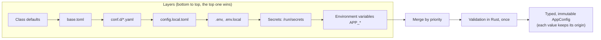
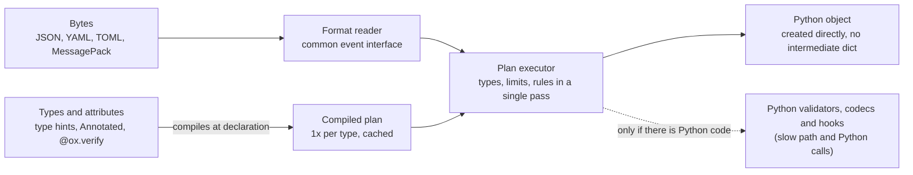
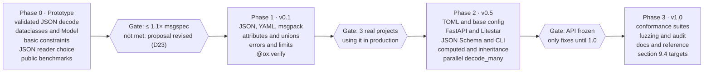

# oxiform — Specification 1.0

2026-10-28 · revised 2026-10-31

**oxiform** is a Python library with a Rust engine that validates and (de)serializes your types to JSON, YAML, TOML and MessagePack in a single pass, and loads layered configuration with the same model. This specification closes the open decisions of version 0.1 and defines what 1.0 must deliver.

## 1. Decisions made

D1–D13 close the 7 open questions from the review and 6 defaults that were implicit. D14–D22 come from the 2026-10-31 review, which resolved inconsistencies and fixed what was missing to start the implementation. D23 is the outcome of gate G1 at the end of phase 0. The rest of the spec already applies them.

| # | Decision | Choice | Why |
| --- | --- | --- | --- |
| D1 | Name | **oxiform** (import: `import oxiform as ox`) | "oxi" (Rust, oxide) + "form" (shape of the data). Free on PyPI and crates.io on 2026-10-28; reserve both now |
| D2 | Ways to declare rules | Three: `Annotated`/`ox.field` (one field), `@ox.verify` (across fields), `@ox.validator` (Python) | Covers all cases without overlap. `@check` was absorbed by `validator`; string rules move to 1.x, only for rules that come from data |
| D3 | Does the constructor validate? | Only the top-level type of each field (`isinstance`, without walking collections). Constraints, rules and deep validation with `validate_init=True` | Building objects in code must be fast; external data enters through `decode`/`convert`, which validate everything |
| D4 | Security limits | On by default, with generous values (section 7) | Safe by default; whoever needs more raises the limit explicitly |
| D5 | `datetime` without timezone | `datetime` requires a timezone; `ox.NaiveDateTime` accepts one without a timezone | The intent is in the type, not in a global flag |
| D6 | YAML backend | saphyr for 1.0 (YAML 1.2); own round-trip layer in 1.x | Maintained and modern; round-trip needs a parser that keeps comments, so it comes later. To be confirmed in the prototype |
| D7 | Governance | License MIT OR Apache-2.0, GitHub organization, at least 2 maintainers with release rights | Standard in the Rust ecosystem; avoids depending on a single person |
| D8 | Supported Python | CPython 3.11–3.14, including free-threaded (3.13t+) | 3.10 reaches end of life in October 2026 |
| D9 | Unknown keys | `unknown="ignore"` in models; `"forbid"` in configs | In APIs, ignoring makes evolution easier; in a config, an unknown key is almost always a typo |
| D10 | Coercion | `strict` in JSON, YAML, TOML and msgpack; `lax` in `convert`, env, CLI and forms | Typed formats do not need to guess; text coming from env/forms does |
| D11 | `Decimal` in JSON | Writes as string; reads string or number | No loss of precision in JavaScript clients |
| D12 | Errors | Collects all, up to `max_errors=100`; `redact_inputs` on when `OXIFORM_ENV=production` | Good for APIs and forms; no data leaks in production |
| D13 | Scope | Small 1.0 (section 2); round-trip, migrations, Arrow, profiles and Rust plugins in 1.x | Reach 1.0 with quality; everything else comes in without breaking the API |
| D14 | Shape of configs | `@ox.config` implies `kw_only=True` and `frozen=True`; every nested model in a config is `@ox.config`; mutable collections are an error | A config is never built by position, so required and optional fields can come in any order. Sections inherit `unknown="forbid"` (a typo in `[server]` is also an error) and the config is immutable end to end, safe to share between threads |
| D15 | GIL and single pass | A decode is a single pass, always with the interpreter; parallelism comes from free-threading and `decode_many(threads=N)` | Releasing the GIL in the middle of a decode requires two passes and costs the speed that keeps oxiform close to msgspec (D23). The real parallelism gain is in batches |
| D16 | What counts as slow path | `strict_rules` forbids `@ox.validator` and lambdas that do not compile. `default_factory`, codecs and Python hooks are "Python calls", visible in `ox.explain` and always allowed; known factories run in Rust | A factory only runs when the field is missing and a Python codec is intentional; treating them as slow rules was noise and made `strict_rules` unusable |
| D17 | Unions | Resolved by wire type (at most one variant per type: object, array, string…) or by tag. Two variants with the same wire type and no tag are an error at import | O(1) choice with no ambiguity; trying in order is slow and surprising, so only with an explicit `ox.Untagged()` |
| D18 | Compiling Python code | Only the lambdas of `@ox.verify` are compiled, and only when the result is guaranteed to equal Python's. `@ox.validator` always runs in Python in 1.0 | Compiling function bodies is a separate project; the validator is the escape hatch and must behave exactly like Python |
| D19 | Paths in errors | Wire names (what the client sent), as a list and as a JSON Pointer | The error describes the input; JSON Pointer is what RFC 9457 and forms use |
| D20 | MessagePack | Only the official timestamp extension; `Decimal` as string; `int` outside 64 bits is an error | Interoperable with any msgpack lib; no value silently loses precision |
| D21 | Wheels | One wheel per Python version (no abi3) | The performance target needs the full C-API, and abi3 does not exist in free-threaded |
| D22 | Format readers | Own event interface (numbers as raw text, positions) and an own pull reader for JSON, chosen over sonic-rs in phase 0 | Serde does not preserve the text of numbers nor detect duplicate keys, and sonic-rs offers no pull interface: going through its DOM adds a tree that the single pass avoids. The interface is the stable contract; the backend is replaceable |
| D23 | Value proposition (gate G1) | Multi-format, validation and config, with JSON speed close to msgspec (at most 2×) and well ahead of pydantic (at least 2×), instead of "the fastest" | The phase 0 prototype decodes at 1.2–1.8× the time of msgspec and 2–4× faster than pydantic v2. Closing the rest needs a native model layout and a SIMD structural reader, which would delay every other feature; that work continues alongside the next phases |

## 2. Scope

1.0 covers the complete cycle of external data (read, validate, write) in four formats, plus layered config. Everything in the 1.x column is designed to come in without breaking the 1.0 API.

| Area | 1.0 | 1.x |
| --- | --- | --- |
| Types | `@ox.model`, `ox.Model`, dataclass, attrs, TypedDict, NamedTuple, inheritance, `@ox.computed`, generics | `ox.Subclasses[T]`, msgspec `Struct` shim |
| Formats | JSON (+ JSON Lines), YAML, TOML, MessagePack | CBOR, canonical JSON (RFC 8785), BSON |
| Validation | Constraints, `strict`/`lax`, `@ox.verify`, `@ox.validator`, context, `ox.Partial`, structured errors | Full i18n, string rules coming from data, compilation of `@ox.validator` |
| Attributes | rename, aliases, defaults, skip, flatten, 4 union modes, include/exclude, `unknown=` | `catch_all`, `array_like`, `groups` |
| Advanced | `iter_decode`, `decode_many`, `ox.Raw` (JSON and MessagePack), JSON Schema | `ox.Lazy`, `ox.View`, `ox.Raw` in YAML/TOML, YAML/TOML round-trip, version migrations, Arrow/Polars |
| Config | Class, files, `glob`, `.env`, env, secrets dir, priority, merge, origin per value, `Secret` | Profiles, interpolation, CLI, hot reload, remote sources |
| Security | Default limits, safe YAML, `redact_inputs` | — |
| Integrations | FastAPI, Litestar, pytest helpers | pydantic/msgspec shims, codemod, Hypothesis, Django |
| Tooling | `ox.explain`, `ox check`, `ox schema`, `ox config explain`, full stubs | `ox convert`, `ox diff`, `ox bench`, TypeScript codegen |
| Extension | Python codecs, `via=`, `__oxiform_*__` protocol | Rust plugins (formats and constraints) |
| Platforms | CPython 3.11–3.14 + free-threaded; Linux, macOS, Windows; x86-64 and ARM64 | PyPy, Pyodide/WASM |

Out of scope in any version: ORM, HTML form generation, asynchronous (I/O) validation inside the engine.

## 3. Models and types

There is one recommended way to declare models (`@ox.model`), one for maximum performance (`ox.Model`), and direct support for the types you already have. All three compile to the same plan in Rust.

### 3.1 Complete example

```python
from datetime import datetime
from decimal import Decimal
from typing import Annotated, Literal
import oxiform as ox
from oxiform import Ge, Le, Len, Pattern, Email

@ox.model(rename_all="camelCase")
class Address:
    street: str
    postal_code: Annotated[str, Pattern(r"^\d{4}-\d{3}$")]
    country: Literal["PT", "DE", "BR"] = "PT"

@ox.model(rename_all="camelCase")
class User:
    id: int
    name: Annotated[str, Len(1, 80)]
    email: Email
    age: Annotated[int, Ge(0), Le(150)] | None = None
    addresses: list[Address] = ox.field(default_factory=list)
    created_at: datetime = ox.field(default_factory=ox.now_utc)

user = ox.json.decode(raw_bytes, User)    # bytes -> validated User
ox.yaml.encode(user)                      # User -> YAML bytes
```

### 3.2 Three ways to declare

| Form | When to use | Example |
| --- | --- | --- |
| `@ox.model` | Default. Generates a dataclass-like class with slots | `@ox.model(frozen=True)` |
| `ox.Model` | Maximum speed and less memory (compact layout in C) | `class Point(ox.Model, frozen=True): ...` |
| Your own types | dataclass, attrs, TypedDict, NamedTuple, without touching the code | `ox.json.decode(raw, MyDataclass)` |

For types that are not yours, the configuration goes in a separate `Codec`:

```python
codec = ox.Codec(ThirdPartyOrder, rename_all="camelCase", unknown="forbid")
order = codec.json.decode(raw)
```

Options of `@ox.model` and `ox.Model`: `frozen`, `kw_only`, `order`, `eq`, `hash`, `rename_all`, `unknown`, `tag`, `tag_field`, `skip_if_default`, `skip_if_none`, `coerce`, `validate_init`, `validate_assignment`, `strict_rules` (signatures in section 11). All models support `pickle`, `copy`, `ox.replace()` (and `copy.replace()` in 3.13+) and `__match_args__`.

Declaration rules:

- **Field order:** a required field after a field with a default requires `kw_only=True`, as in dataclasses. `@ox.config` already implies it (D14).
- **Defaults** are validated and converted once, when the plan is compiled. An invalid default is a declaration error.
- **When it compiles:** the plan is compiled in the decorator. Forward refs to classes not yet defined are resolved on first use or in `ox.warmup()`. Types that are not yours are compiled on first use. Declaration errors raise `ox.SchemaError` at that moment.
- **Instance creation in decode:** oxiform does not call `__init__`, it fills the slots directly. If the type has `__post_init__` (models and dataclasses) or attrs validators and converters, they are called (Python calls, section 9.2).

### 3.3 Inheritance

Subclasses inherit fields, attributes, rules and options from the model (except `tag`, which belongs to each class). They can add fields and rules, but not remove fields.

```python
@ox.model(tag_field="kind")
class Animal:
    name: str

@ox.model(tag="dog")
class Dog(Animal):
    breed: str

@ox.model(tag="cat")
class Cat(Animal):
    indoor: bool

pet = ox.json.decode(b'{"kind": "dog", "name": "Rex", "breed": "lab"}', Dog | Cat)
```

- A union of models that all declare the same `tag_field` is resolved by that field, as if it were `ox.Tagged("kind")` (section 5.3).
- Encode always writes the tag. When reading a concrete type (`Dog`), the tag is optional, but if present it must be the right one (`tag` error).
- Without `tag`, the tag value is the class name with the model's `rename_all`.

### 3.4 Computed fields

```python
@ox.model
class Order:
    items: list[Item]

    @ox.computed
    def total(self) -> Decimal:       # appears in encode and JSON Schema; ignored in decode
        return sum((i.qty * i.price for i in self.items), Decimal(0))
```

- `@ox.computed(cache=True)` computes once per instance (only in `frozen` models).
- On read, the key of a computed field is ignored, even with `unknown="forbid"`, so that `decode(encode(x)) == x`.

### 3.5 Types supported on the fast path

| Category | Types |
| --- | --- |
| Scalars | `int` (no size limit), `float`, `bool`, `str`, `bytes`, `bytearray`, `None` |
| Numbers | `Decimal`, `Fraction` |
| Time | `datetime` (with timezone), `ox.NaiveDateTime`, `date`, `time`, `timedelta`, `ZoneInfo` |
| Identifiers | `UUID`, `ipaddress.*`, `Path`, `ox.Email`, `ox.Url`, `ox.HttpUrl` |
| Collections | `list`, `tuple` (fixed and variable), `set`, `frozenset`, `dict` (keys `str`, `int`, `UUID`, `date`, `Enum`), `Sequence`, `Mapping` |
| Algebraic | `Union`, `Optional`, `Literal`, `Enum`, `IntEnum`, `StrEnum`, `Flag` |
| Generics | `class Page[T]` (PEP 695), `TypeVar`, `NewType`, `type Alias = ...` |
| Structures | `@ox.model`, `ox.Model`, dataclass, attrs, `TypedDict` (with `Required`/`NotRequired`/`ReadOnly`), `NamedTuple` |
| Recursive | Self-referencing models, `type Tree = dict[str, Tree] \| int` |
| Special | `Any`, `ox.Raw` (fragment left to decode, JSON and MessagePack), `ox.Secret[T]` |

Representation:

- Models, dataclass, attrs and `TypedDict` map to objects; `tuple` and `NamedTuple` to arrays.
- On read, `Sequence` gives `list` and `Mapping` gives `dict`. In configs, `Mapping` gives a read-only mapping (section 6.1).
- `ox.Email`, `ox.Url` and `ox.HttpUrl` are aliases of `Annotated[str, ...]`: the value is still a `str`, as it was received.
- A specialized generic (`Page[User]`) has its own cached plan.

Types outside the list come in through codecs (section 8).

## 4. Validation

Validation runs during parsing, in the same pass in Rust. There are three ways to declare rules (D2), and all those that do not call Python code stay on the fast path.

### 4.1 Rules for one field: `Annotated` or `ox.field`

```python
Positive = Annotated[int, ox.Gt(0)]                   # reusable alias
Sku = Annotated[str, ox.Strip(), ox.Upper(), ox.Pattern(r"^[A-Z]{3}-\d{4}$")]

@ox.model
class Product:
    sku: Sku
    price: Annotated[Decimal, ox.Ge(0), ox.Digits(max=12, decimals=2)]
    stock: Positive
    tags: Annotated[list[str], ox.Len(max=10), ox.Unique()]
    rating: float = ox.field(ge=0, le=5, default=0.0)   # equivalent shortcut
```

| Family | Constraints |
| --- | --- |
| Number | `Ge`, `Gt`, `Le`, `Lt`, `MultipleOf`, `Digits(max, decimals)`, `Finite` |
| Text | `Len`, `Pattern`, `StartsWith`, `EndsWith`, `Contains`, `Ascii`, `NonBlank` |
| Transformations | `Strip`, `Lower`, `Upper`, `NormalizeUnicode(form)`, `Truncate(n)` |
| Collections | `Len`, `Unique`, `Each(*constraints)`, `Keys(*constraints)`, `Values(*constraints)` |
| Formats | `Hostname`, `IPv4`, `IPv6`, `Cidr`, `Iban`, `Semver`, `Slug`, `Base64`, `Hex` |
| Time | `Past`, `Future`, `After`, `Before` |
| General | `OneOf`, `NotIn`, `Const` |

- **Shortcuts in `ox.field`:** accepts the single-value constraints: `ge`, `gt`, `le`, `lt`, `multiple_of`, `min_len`, `max_len`, `pattern`. The others are declared with `Annotated`.
- **Transformations** run after the type and before the checks, in the order they appear.
- **Compatibility:** a constraint on a type where it makes no sense (`Strip` on an `int`, `Ge` on a `list`) is a declaration error.
- **`Pattern`** uses the `regex` crate, without backtracking. Lookaround and backreferences are a declaration error. It searches anywhere in the text (like `re.search` and the JSON Schema `pattern`); to match the whole text, anchor with `^…$`.
- **`Unique`** requires hashable elements, checked at declaration.
- **`Past` and `Future`** compare against the clock read at the start of the decode.

### 4.2 Rules across fields: `@ox.verify`

Accepts constraints on a field (`ox.on`), lambdas, `ox.rule` and `ox.RuleSet`.

```python
DateRange = ox.RuleSet(
    ox.rule(lambda o: o.start <= o.end, path="end", message="end must be after start"),
    lambda o: (o.end - o.start).days <= 365,
)

@ox.model
@ox.verify(
    DateRange,
    ox.on("budget", ox.Ge(0)),
    lambda o: len(o.items) > 0 or o.status == "draft",
    ox.rule(lambda o: sum(i.qty * i.price for i in o.items) == o.total, path="total"),
)
class Order:
    start: date
    end: date
    status: Literal["draft", "confirmed"]
    budget: Decimal
    items: list[Item]
    total: Decimal

ox.verify(DateRange)(ThirdPartyBooking)     # also on types that are not yours
```

**Compilation (D18).** Lambdas are read once and compiled to Rust when they use this subset: comparisons, `and`/`or`/`not`, arithmetic, `len`, `sum`, `min`, `max`, `any`, `all`, `in`, attributes, indexes, generators over model collections and the attributes of `date`, `datetime` and `timedelta`. Compilation only happens if the result is guaranteed to equal Python's:

- **Free names** (globals or closure) only if they are immutable constants (`int`, `str`, `tuple`, `frozenset`…), read at compile time. Other names make the rule run in Python.
- **`Decimal`** uses the thread's decimal context. If the context is not the default, the rule runs in Python in that decode.
- **The source** is located with the code object positions (3.11+). Without available source (REPL, `exec`), the rule runs in Python.

**Execution:**

- A rule only runs if the fields it uses passed validation; otherwise it is skipped, because the field error already explains the problem.
- A rule without `path` reports the error at the model root.
- Field names given as strings are checked at declaration, with a suggestion in case of a typo.
- A lambda that does not compile runs in Python and shows up as slow path in `ox.explain`; with `strict_rules=True` it is a declaration error.
- The order between `@ox.model` and `@ox.verify` does not matter.

### 4.3 Logic in Python: `@ox.validator`

For what cannot be declared. Always runs in Python (D18).

```python
@ox.model
class Signup:
    username: Annotated[str, ox.Len(3, 30)]
    password: str
    password2: str

    @ox.validator("username")                   # one field, after the constraints
    def not_reserved(cls, v: str) -> str:
        if v in RESERVED:
            raise ox.Invalid("reserved name", code="reserved")
        return v

    @ox.validator("username", mode="before")    # raw value, before the type
    def lower(cls, v):
        return v.lower() if isinstance(v, str) else v

    @ox.validator                               # whole model, after everything
    def passwords_match(self) -> None:
        if self.password != self.password2:
            raise ox.Invalid("passwords do not match", path="password2")

    @ox.validator("username")
    def same_tenant(cls, v, ctx: ox.Context):   # external data via context=
        ...

ox.json.decode(raw, Signup, context={"tenant": tenant})
```

- Field validators are classmethods (they receive `cls`) and return the value, possibly changed. Model validators receive `self` and return `None`.
- The context arrives in the parameter annotated with `ox.Context`.
- `ox.Invalid`, `ValueError` and `TypeError` become validation errors at the field path. Any other exception propagates as is.
- `strict_rules=True` forbids `@ox.validator` (D16).

### 4.4 Execution order

For each model:

1. `mode="before"` validators, with the raw value.
2. Type and coercion (section 4.5).
3. Transformations, in the declared order.
4. Field constraints.
5. `mode="after"` field validators.
6. Defaults for missing fields (`missing` error if there is none), instance creation and `__post_init__`.
7. `@ox.verify` rules, in the declared order.
8. Model validators.

- If any field failed, the instance is not created: step 7 runs only the rules whose fields passed, step 8 does not run, and the result is `ValidationError`.
- Nested models complete before the model that contains them.
- In inheritance, rules and validators of the base run before those of the subclass.

### 4.5 Coercion (D10)

| Input → target | `strict` | `lax` |
| --- | --- | --- |
| `"42"` → `int` | error | `42` |
| `42` → `float` | `42.0` | `42.0` |
| `4.5` → `int` | error | error (loss of information) |
| `true` → `int` | error | error (`bool` is never a number) |
| `"true"`, `"1"`, `"yes"` → `bool` | error | `True` |
| `""` → `int \| None` | error | `None` (only when the type does not accept `str`) |
| `"1.5"` or `1.5` → `Decimal` | accepted (D11) | accepted |
| `"2026-10-28T10:00:00Z"` → `datetime` | accepted (ISO string is the native form in JSON and YAML) | accepted |
| `[1, 2]` → `tuple[int, int]` | `(1, 2)` | `(1, 2)` |

Fine-tuning without changing mode: `@ox.model(coerce={int: [str]})` accepts integers as strings only in that model.

### 4.6 When validation happens

| Moment | Default | To change |
| --- | --- | --- |
| `decode`, `convert` | Everything | `validate=False` for trusted data (types only) |
| Constructor `User(...)`, `ox.replace(...)` | Only the top-level type of each field (D3) | `validate_init=True` |
| Assignment `u.age = -1` | Nothing | `validate_assignment=True` |
| `ox.validate(obj)` | Everything | — |
| `encode` | Nothing | `validate=True` |
| PATCH | — | `ox.Partial[User]` (below) |

`decode(raw, ox.Partial[User])` returns a `dict` with only the fields present, with Python names, each validated as in the model. Model rules do not run, because the object is incomplete; apply them with `ox.validate(ox.replace(user, **patch))`.

### 4.7 Errors

`ox.ValidationError` holds the list of errors. Each error has this shape, which is public API:

```python
{
    "code": "too_short",                 # stable (section 11.2)
    "path": ["addresses", 0, "street"],  # wire names (D19)
    "pointer": "/addresses/0/street",    # JSON Pointer
    "message": "length 0 < minimum 1",
    "input": "",                         # truncated to 80 characters; omitted with redact_inputs
    "ctx": {"min": 1, "max": 80, "actual": 0},
}
```

```text
3 errors validating User (json):
  /id      expected int, received str "x"        [type]
  /name    length 0 < minimum 1                  [too_short]
  /email   invalid email: missing "@"            [format]
```

```python
e.errors()       # list[dict]
e.to_problem()   # RFC 9457 (application/problem+json), with "errors": [{"pointer", "code", "detail"}]
e.by_path()      # {"/email": [...]} for forms
e.truncated      # True if it stopped at max_errors
```

- Collects all errors up to `max_errors=100`; `fail_fast=True` stops at the first.
- Messages are in English by default. `ox.messages.override(code, template)` changes any message by code; the template uses the fields of `ctx` (`"must be at least {min} characters"`).

Exception hierarchy:

| Exception | Inherits from | When |
| --- | --- | --- |
| `ox.OxiformError` | `Exception` | Base of all |
| `ox.ValidationError` | `OxiformError`, `ValueError` | Invalid input |
| `ox.DecodeError` | `ValidationError` | The input could not be read at all: `syntax`, `limit_exceeded`, `config_source` |
| `ox.EncodeError` | `OxiformError` | Object that cannot be written in the requested format |
| `ox.SchemaError` | `OxiformError`, `TypeError` | Invalid declaration |

`except ox.ValidationError` catches all invalid input, including malformed input.

## 5. Serialization

All formats have the same API and share the same internal data model. Attributes are declared once and apply to all of them.

### 5.1 Formats and API

| Module | Rust backend | Notes |
| --- | --- | --- |
| `ox.json` | own pull reader (D22) | JSON Lines, `indent`, `sort_keys` |
| `ox.yaml` | saphyr | YAML 1.2, multi-document, safe tags only |
| `ox.toml` | toml | TOML 1.0 |
| `ox.msgpack` | rmp | Official timestamp (ext −1) for `datetime` (D20) |

Each module exposes the same functions (full signatures in section 11):

```python
ox.json.decode(data, type=Any, *, mode="strict", context=None, limits=None)   # -> T
ox.json.encode(obj, *, include=None, exclude=None, policy=None)             # -> bytes
ox.json.iter_decode(source, type=Any, *, path=None, lines=False)            # -> Iterator[T]
ox.json.decode_many(docs, type, *, on_error="raise", threads=1)             # -> DecodeResult
ox.json.Encoder(**opts) / ox.json.Decoder(type, **opts)                     # reusable
```

- **`data`** can be `bytes`, `bytearray`, `memoryview` or `str`. The encoding is always UTF-8.
- **`decode`** reads exactly one document. A YAML with several documents is read with `iter_decode`.
- **`iter_decode(source)`** accepts bytes, a binary file or a `Path`.
  - `path` is the JSON Pointer of the array to walk (`"/items"`), and `lines=True` reads JSON Lines (JSON only).
  - In YAML it returns one item per document; in MessagePack, one per concatenated object.
  - `ox.toml` has no `iter_decode`, because a TOML document cannot be read as a stream.
- **`decode_many(docs)`** takes an iterable of documents and returns a `DecodeResult`:
  - `.values` has one value per document, with `None` where it failed.
  - `.errors` is a dict index → `ValidationError`, filled with `on_error="collect"`.

Without a type, `decode` returns builtins, so oxiform also works as a fast replacement for `json`, `yaml` and `tomllib`. Outside the formats, `ox.convert(obj, type, mode="lax")` validates data that is already in Python, and `ox.to_builtins(obj)` does the reverse, with the representations of `ox.json`.

### 5.2 Field attributes

```python
@ox.model(rename_all="camelCase", kw_only=True)
class Invoice:
    invoice_id: int = ox.field(rename="id")
    customer: str = ox.field(aliases=["client"])            # old name accepted on read
    notes: str = ox.field(default="", skip_if_default=True)
    internal_score: float = ox.field(default=0.0, skip=True)
    password_hash: str = ox.field(skip_encode=True)          # input only
    meta: Meta = ox.field(flatten=True)
    amount: Decimal = ox.field(codec=ox.codecs.decimal_as_number)
```

| Attribute | Effect |
| --- | --- |
| `rename`, `rename_all` | Wire name: `camelCase`, `PascalCase`, `snake_case`, `kebab-case`, `SCREAMING_SNAKE_CASE`. `rename` wins over `rename_all` |
| `aliases` | Alternative names accepted on read only |
| `default`, `default_factory` | Value when the field is missing |
| `skip`, `skip_encode`, `skip_decode` | Field in neither direction or in only one. `skip` and `skip_decode` require a default |
| `skip_if`, `skip_if_default`, `skip_if_none` | Omit on write. The last two also exist as a model option |
| `flatten` | Embed the fields of another model at the same level. Colliding names are a declaration error |
| `codec` | Custom serialization for this field only |
| `doc`, `examples`, `deprecated` | Metadata for JSON Schema |
| `env`, `merge` | Configs only (section 6); outside configs they are a declaration error |

### 5.3 Unions (D17)

How the variant is chosen:

- **By wire type** (null, bool, number, string, array, object). Works on its own when each variant has a different wire type: `int | str`, `Address | None`, `list[int] | str`. In `int | float`, a number without a decimal part gives `int`.
- **By tag**, when two variants share the wire type (two models, or `datetime | str`). The tag comes from the `tag_field` of the models (section 3.3) or from one of the modes below. Without a tag, it is a declaration error.
- **Ambiguity:** checked with the JSON rules, the poorest format, so that the same type works in all of them.

The four Serde modes:

```python
Payment = Annotated[Card | Pix, ox.Tagged("type")]                   # {"type": "card", ...}
Payment = Annotated[Card | Pix, ox.Tagged("type", content="data")]   # {"type": "card", "data": {...}}
Payment = Annotated[Card | Pix, ox.External()]                       # {"card": {...}}
Payment = Annotated[Card | Pix, ox.Untagged()]                       # tries in order
```

- With a tag, the variant is chosen in O(1). `ox.Untagged()` tries each variant in order, and the error shows why each one failed.
- The tag value comes from `@ox.model(tag="card")`; without it, it is the class name with the model's `rename_all`.
- An `ox.Tagged` with a field different from the models' `tag_field` is a declaration error.

### 5.4 Include and exclude

```python
ox.json.encode(user, exclude={"password_hash": True, "addresses": {"street": True}})
ox.json.encode(user, include={"id", "name"})
```

Accepts sets of names or nested dicts. Paths use Python names, not wire names. On a field that is a collection, the rule applies to each element. Nonexistent names are `EncodeError`.

### 5.5 Representation per format

By default each format's native representation is used; `ox.Policy` changes it per call or per `Encoder`.

| Python type | JSON | YAML | TOML | MessagePack |
| --- | --- | --- | --- | --- |
| `datetime` | RFC 3339 string | RFC 3339 string | native offset date-time | timestamp (ext −1) |
| `ox.NaiveDateTime` | ISO 8601 string | ISO 8601 string | native local date-time | ISO 8601 string |
| `date`, `time` | ISO 8601 string | ISO 8601 string | native | ISO 8601 string |
| `timedelta` | ISO 8601 string (`P1DT2H`) | same | same | same |
| `Decimal` | string (D11) | string | string | string (D20) |
| `UUID`, `Enum` with `str` value | string | string | string | string |
| `bytes` | base64 | `!!binary` | base64 | native binary |
| `None` | `null` | `null` | field omitted (below) | `nil` |
| `float` NaN/Inf | error | `.nan`/`.inf` | `nan`/`inf` | native |
| `int` > 64 bits | number | number | error (TOML limit) | error (D20) |
| `set`, `frozenset` | sorted array | sorted array | sorted array | sorted array |

- **TOML has no null.** `None` omits the field, and on read a missing `T | None` field is read as `None` (TOML only). `None` inside an array, or a document whose top level is not a table, gives `EncodeError`.
- **YAML 1.2:** `yes`, `no`, `on`, `off` are strings, not booleans. The core schema has no timestamp type, so dates are ISO strings, as in JSON.
- **Sets** are written sorted when the elements are comparable, so that the same value always produces the same bytes (section 10.2).
- **`ox.Secret`** is written as `"********"`; `ox.Policy(secrets="reveal")` writes the real value (for example, to generate a config file).

```python
ox.json.encode(x, policy=ox.Policy(decimal="number", bytes="hex", datetime="unix_ms"))
```

| `ox.Policy` option | Values |
| --- | --- |
| `datetime` | `"rfc3339"` (default), `"unix"`, `"unix_ms"` |
| `decimal` | `"string"` (default), `"number"` |
| `bytes` | `"base64"` (default), `"base64url"`, `"hex"` |
| `nan` | `"error"` (default), `"null"` |
| `secrets` | `"mask"` (default), `"reveal"` |

Numeric guarantees:

- `float` round-trips exactly: the value read is the same, bit for bit.
- `int` never loses precision; when the format cannot hold it, it is an error.
- `Decimal` and `Fraction` are read from the text of the number, never through `float`.

## 6. Layered configuration (`oxiform.config`)

A config is an oxiform model loaded from several sources in priority order, merged and validated once at the end. Each value remembers where it came from.

### 6.1 Declaring

`@ox.config` is `@ox.model` with the config defaults (D14): `kw_only=True`, `frozen=True` and `unknown="forbid"` (D9).

- **Free order:** fields are by name only, so required and optional fields can come in any order.
- **Sections** are nested configs, also declared with `@ox.config`.
  - Applies to any model inside a config, including elements of collections; another kind of model is a declaration error, with a suggestion.
  - `env_prefix` and `env_nested` only count on the type passed to `cfg.load`.
- **Optional section:** write `= Server()`. Sharing the default instance is safe because it is immutable, and the type checker sees the default.
- **Collections:** use `tuple[T, ...]`, `frozenset[T]` and `Mapping[K, V]`. `list`, `set` and `dict` are a declaration error, with the right type suggested.
  - `Mapping` is materialized as a read-only mapping. It is picklable, and the concrete type is not public API.

```python
@ox.config
class Database:
    url: ox.Url
    pool_size: Annotated[int, ox.Ge(1), ox.Le(100)] = 10
    password: ox.Secret[str]                  # required after a default: ok

@ox.config
class Server:
    host: str = "127.0.0.1"
    port: Annotated[int, ox.Ge(1), ox.Le(65535)] = 8000
    workers: int = ox.field(default=1, env="WEB_CONCURRENCY")

@ox.config(env_prefix="APP_", env_nested="__")
class AppConfig:
    debug: bool = False
    server: Server = Server()                 # optional section
    db: Database                              # required section
    plugins: tuple[str, ...] = ox.field(default=(), merge="append")
```

### 6.2 Sources and priority

The order of the list is the priority: the source at the bottom wins. You can repeat the same kind of source as many times as you like; each one is a layer.

```python
from oxiform import config as cfg

settings = cfg.load(AppConfig, sources=[
    cfg.file("config/base.toml"),
    cfg.glob("config/conf.d/*.yaml"),                     # alphabetical order
    cfg.file("config.local.toml", optional=True),
    cfg.dotenv(".env", ".env.local", optional=True),
    cfg.secrets_dir("/run/secrets", optional=True),     # Docker / Kubernetes
    cfg.env(),                                           # APP_DB__POOL_SIZE=20
])
```

| Source | Names and coercion |
| --- | --- |
| `cfg.file(path)` | TOML, YAML or JSON by extension. Wire names, `strict` |
| `cfg.glob(pattern)` | Several files, alphabetical order (by bytes, no locale). Like `file` |
| `cfg.pyproject("tool.myapp")` | Section of `pyproject.toml`. Like `file` |
| `cfg.dotenv(*paths)` | One or more `.env` files. Like `env`; does not change `os.environ` |
| `cfg.env()` | Python name in uppercase with `env_prefix` and `env_nested` (`APP_DB__POOL_SIZE`), case-insensitive. `ox.field(env=...)` gives the exact name, without prefix. `lax` |
| `cfg.secrets_dir(path)` | One file per value, named after the matching environment variable (`app_db__password`), case-insensitive; the trailing `\n` is removed. `lax` |
| `cfg.mapping(dict)` | Overrides coming from code. Python names, `lax` |

- **Composite values** (collections and whole sections) in env, `.env` and secrets dir are written in JSON: `APP_PLUGINS='["auth", "billing"]'`.
- **Positions:** config files are read with a reader that keeps the line of each value, for the origin and for errors. They are small, so this reading is not part of the performance targets.
- **Required fields:** the class defaults are always the lowest layer. Required fields are only checked after the merge, so no source has to be complete.



### 6.3 Merge

- The merge is done on the raw data, before validation. Each value keeps its source and is validated with the mode of that source: `strict` if it came from a file, `lax` if it came from env.
- Sections merge key by key; scalars and collections are replaced.
- Per field: `merge="replace"` (any type), `"append"` (`tuple`), `"union"` (`frozenset`) or `"deep"` (`Mapping`). A strategy that does not fit the type is a declaration error.
- `"__unset__"` in an upper layer goes back to the class default.

### 6.4 Origin of each value

```python
cfg.origin(settings, "db.pool_size")
# Origin(source="env", key="APP_DB__POOL_SIZE", line=None, overrides=["config/base.toml:12"])
```

Errors use the same information (`db.pool_size = 500 > maximum 100 (config/conf.d/prod.yaml:6)`), and `ox config explain app.settings:AppConfig` shows the table key · value · origin, with secrets hidden.

### 6.5 Secrets and tests

- `ox.Secret[T]` shows `********` in `repr`, logs, errors and `encode`; the real value only comes out with `.reveal()`. In JSON Schema it appears with `writeOnly: true`.
- `cfg.dump(settings)` exports the final config, with secrets as `"********"`.
- `cfg.override(settings, server__port=0)` returns a changed and validated copy, for tests.

In 1.x: profiles (`[prod]`), `${...}` interpolation, CLI flags generated from the model, hot reload and remote sources (Vault, AWS SSM). The API above already accommodates them as new sources and options.

## 7. Security and limits

oxiform assumes the input is not trusted: limits are on by default (D4) and YAML never builds arbitrary objects. Exceeding a limit gives `ox.DecodeError` with the code `limit_exceeded`, never a crash.

| Limit | Default | Protects against |
| --- | --- | --- |
| `max_bytes` | 64 MiB per document (in `iter_decode`, per item) | Giant payloads |
| `max_depth` | 128 levels | Stack overflow with deep nesting |
| `max_items` | 1,000,000 per collection | Huge arrays and objects |
| `max_str_len` | 16 MiB per string | Giant strings |
| `max_int_digits` | 4,300 digits (same as CPython) | Huge integers that block the CPU |
| `max_yaml_aliases` | 1,000 alias expansions, counting nested ones | "Billion laughs" in YAML |

The number of collected errors has a separate limit: `max_errors=100` in each call (section 4.7).

```python
ox.json.decode(raw, User, limits=ox.Limits(max_bytes=1_000_000, max_depth=32))
ox.set_defaults(limits=ox.Limits(max_bytes=256 * 2**20))   # global, at startup
ox.json.decode(trusted, Big, limits=ox.Limits.none())       # turn off, explicitly
```

Other guarantees:

- **Safe YAML:** only YAML 1.2 core schema tags and `!!binary`; unknown tags are an error. There is no unsafe mode.
- **Duplicate keys** in an object are an error in all formats (`duplicate_key`), instead of "the last one wins".
- **Regex without backtracking** (`regex` crate): no ReDoS, even with patterns coming from configuration.
- **Internal hash tables** (for example, in duplicate key detection) use a random seed, against collision attacks. Field lookup uses a perfect hash, immune by construction.
- **Sensitive data in errors:**
  - With `redact_inputs`, errors omit the received value. It is on by default when `OXIFORM_ENV=production` (read at import) and can be changed with `ox.set_defaults(redact_inputs=...)`.
  - `ox.Secret` never appears in errors, logs or `repr`.
- **`unsafe` code** only in isolated modules (the bridge to the CPython C-API and the readers), with continuous fuzzing and mandatory review by a second maintainer.
- **Distribution chain:** releases through PyPI Trusted Publishing, with attestations and SBOM.

## 8. Extensibility, integrations and tooling

In 1.0 extension is done in Python (codecs, `via=`, protocol); Rust plugins arrive in 1.x. The 1.0 integrations are the ones that weigh most on adoption: FastAPI, Litestar and pytest.

### 8.1 Codecs

```python
@ox.codec(Money)
class MoneyCodec:
    wire = tuple[Decimal, Annotated[str, ox.Len(3, 3)]]   # validated in Rust before decode

    @staticmethod
    def encode(m: Money) -> tuple[Decimal, str]:
        return (m.amount, m.currency)

    @staticmethod
    def decode(v: tuple[Decimal, str]) -> Money:
        return Money(*v)

ox.register(ULID, via=str)                                  # constructor and str() are enough
ox.register(Color, via=str, parse=Color.from_hex, dump=Color.hex)
```

- **Precedence:** field codec > local `Codec` > global registry.
- **Protocol:** a lib can support oxiform without depending on it at runtime, by defining on its own class:
  - `__oxiform_encode__(self)`, which returns builtins;
  - `__oxiform_decode__(cls, value)`, a classmethod that receives builtins;
  - `__oxiform_schema__(cls)`, optional, a classmethod that returns the JSON Schema.
- **Errors:** `ox.Invalid`, `ValueError` and `TypeError` raised in a `decode` become validation errors at the field path.
- **Global registries** (`ox.register`, `ox.messages.override`, `ox.set_defaults`) are set at startup. Registering a codec for a type that is already in a compiled plan is `SchemaError`.

### 8.2 Integrations

| Integration | Install | What it does |
| --- | --- | --- |
| FastAPI | `oxiform[fastapi]` | oxiform models as body, query and response; generated OpenAPI; 422 errors in RFC 9457 |
| Litestar | `oxiform[litestar]` | `OxiformPlugin` with the same behavior |
| pytest | included | `oxiform.testing`: `assert_valid(obj)` and `assert_round_trip(obj, formats=...)` |
| ORMs | included | `ox.convert(row, Model, from_attributes=True)` reads SQLAlchemy and Django objects without going through a dict |

```python
from oxiform.integrations.fastapi import OxiformRoute

app = FastAPI()
app.router.route_class = OxiformRoute

@app.post("/orders")
async def create(order: Order) -> Order:
    return order
```

Integrations support the last two minors of each framework and are tested against them on every PR.

### 8.3 Type checkers and IDE

- `@ox.model`, `@ox.config` and `ox.Model` use `dataclass_transform` (PEP 681): pyright, mypy and ty understand constructors and defaults without a plugin. `@ox.config` declares `kw_only_default=True` and `frozen_default=True`, so the checker sees the same as the runtime.
- The type of `decode(data, User)` is `User`. The `type` parameter is annotated with `TypeForm[T]` (PEP 747), so unions and `Annotated` are also typed in the checkers that support it; in the others, those cases give `Any`.
- Full stubs and `py.typed`; `Annotated[int, ox.Ge(0)]` is still `int` for the checker.
- Declaration errors raise `ox.SchemaError` with a suggested fix. Examples: nonexistent field, duplicate `rename`, invalid lambda, required field after a default without `kw_only`, constraint on an incompatible type, ambiguous union, mutable config section.

### 8.4 `ox.explain` and CLI

```text
>>> ox.explain(Order)
Order  (plan: 14 nodes, 1 slow path)
  status     Literal['draft','confirmed']    fast
  items      list[Item]                      fast
  rule       start <= end                    fast (compiled)
  validator  check_stock()                   SLOW  python
```

| Command | Purpose |
| --- | --- |
| `ox check app.models:User data.json` | Validates a file against a model (CI) |
| `ox schema app.models:User` | Exports JSON Schema 2020-12 |
| `ox config explain app.settings:AppConfig` | Final config values and the origin of each one |
| `ox config check app.settings:AppConfig` | Validates the config without starting the app |

The CLI also runs as `python -m oxiform`.

## 9. Architecture and performance

Each type is compiled once into a plan (a small IR) that a Rust executor runs against the events of the format reader, creating the Python objects directly. The executor is the same for all formats.



Encode walks the plan of the runtime type of each object, in the reverse direction.

### 9.1 Components

| Component | Responsibility |
| --- | --- |
| Introspection (Python) | Reads annotations, `Annotated`, attributes and rules with the `typing` APIs; resolves forward refs and generics; produces a description of the type |
| Compiler (Rust) | Validates the description, compiles rules and generates the plan; cached per class |
| Plan (IR) | Immutable nodes (`Int{ge,le}`, `Str{len,pattern}`, `Struct{fields}`, `Union{tag}`, `Call{py}`); field lookup (with aliases) by perfect hash |
| Readers and writers | One per format, all with the same event interface (D22): start and end of map and sequence, key, scalar with numbers as raw text, position for errors. No intermediate tree |
| Executor | Validates types, limits, constraints and rules. Generic over the target: Python objects or a Rust tape (section 9.3). Does not depend on Python |
| Python bridge | Creates instances (slots, `ox.Model`), calls Python code and measures time for `ox.explain`. It is the only place with C-API calls |

### 9.2 Fast path and slow path

- **Fast path:** types from section 3.5, all constraints, compilable lambdas of `@ox.verify`, attributes, unions, limits and the factories in the table below.
- **Slow path (rules):** `@ox.verify` lambdas that do not compile and all `@ox.validator` (D18). Visible in `ox.explain`; forbidden with `strict_rules=True`.
- **Python calls:** Python codecs, `default_factory` outside the table, `skip_if`, `__post_init__` and attrs validators and converters. Visible in `ox.explain` with the measured cost, but always allowed (D16).

| `default_factory` that runs in Rust | Examples |
| --- | --- |
| No-argument constructors of fast path types | `list`, `dict`, `set`, `frozenset`, `tuple`, `str`, `bytes`, `int`, `float`, `bool`, `Decimal` |
| oxiform factories | `ox.now_utc`, `ox.uuid4`, `ox.uuid7` (and stdlib `uuid.uuid4`/`uuid.uuid7`, recognized by identity) |
| oxiform models with all fields having a default | `default_factory=Address` |

### 9.3 Concurrency (D15)

A decode is a single pass: the executor creates the Python objects as it reads, so it needs the interpreter from start to finish. Splitting the decode into two passes (validate without the GIL, materialize afterwards) would cost an extra traversal and intermediate memory, which would move it further from msgspec (D23). Parallelism comes from elsewhere:

| Situation | Behavior |
| --- | --- |
| `decode`/`encode` in one thread | Single pass, with the GIL (or with the thread attached to the interpreter, in free-threaded) |
| Several threads in free-threaded (3.13t+) | Real parallelism: immutable plans, shared without locks |
| `decode_many(threads=N)` in free-threaded | N threads, each in a single pass |
| `decode_many(threads=N)` with GIL | Phase 1 in parallel, without the GIL: parse, types, limits and constraints into a compact Rust tape. Phase 2 with the GIL: materializes the objects and runs the Python code |
| `iter_decode` over a `Path` or a file with `fileno()` | I/O reading runs without the GIL. Other objects are read with `.read()`, in Python |

Memory guarantees of the `unsafe` bridge:

- `bytes` and `str` are read without copying because they are immutable. `bytearray`, writable `memoryview` and `mmap` are copied before parsing: a Python validator or another thread could change them midway.
- Encode reads lists and dicts inside per-object critical sections (the mechanism of free-threaded CPython). Mutating an object while another thread encodes it never causes a crash or corrupted bytes; each container is written in the state in which it was read.

The phase 1 tape is also the basis of `ox.Lazy` and `ox.View` in 1.3.

### 9.4 Performance targets (release gate)

Measured on a public, reproducible benchmark, against the latest versions of each lib. 1.0 only ships if all of them are met.

| Scenario | Target |
| --- | --- |
| JSON decode + validation (small, 20-field and nested models) | ≤ 2× the time of msgspec; ≥ 2× faster than pydantic v2 |
| JSON encode of models | ≤ 2× the time of msgspec |
| JSON encode of dicts | ≤ 1.5× the time of orjson |
| Typed YAML decode | ≥ 10× faster than PyYAML (CLoader) + pydantic |
| Typed TOML decode | ≥ 5× faster than tomllib + pydantic |
| `decode_many(threads=4)`, 10,000 documents | ≥ 3× `threads=1` in free-threaded; ≥ 1.5× in GIL builds |
| Import + compilation of 100 models | < 50 ms |
| Memory per `ox.Model` instance | ≤ dataclass with slots |

## 10. Compatibility, stability, tests and conformance

From 1.0 on, oxiform follows strict semver, and the promise of "all formats" is verified by official suites and differential tests on every PR.

### 10.1 Platforms (D8)

| Dimension | 1.0 |
| --- | --- |
| Python | CPython 3.11, 3.12, 3.13, 3.14; free-threaded builds 3.13t and 3.14t |
| Systems | Linux (manylinux and musllinux), macOS 11+, Windows |
| Architectures | x86-64 and ARM64 |
| Wheels | One per Python version and platform, no abi3 (D21), plus sdist |
| Version policy | A Python version leaves support at the first minor after its end of life |

### 10.2 What is public API

- Everything in section 11.1. Any other symbol, even without an underscore, is internal.
- The error codes (section 11.2) and the shape of each error (section 4.7).
- The output format of each format: for the same inputs and options, the same model produces the same bytes.
- Names of `ox.field` attributes and `@ox.model` options.
- **Not** public API: the text of error messages, the format of `ox.explain`, the internal plan and the concrete types returned where the spec only promises a protocol (for example, the read-only mapping of configs).

### 10.3 Changes

- Breaking changes only in a major. A deprecation emits `ox.OxiformDeprecationWarning` for at least 2 minors before removal.
- Security fixes may change behavior in a patch (e.g., a new limit), always documented in the changelog.
- The last minor of each major receives security fixes for 12 months after the next major.

### 10.4 Tests and conformance

| Type | What it verifies | When it runs |
| --- | --- | --- |
| Official suites | JSONTestSuite, yaml-test-suite, toml-test: 100% of accept and reject cases | Every PR |
| Round-trip | `decode(encode(x)) == x` for all supported types, in all formats, with Hypothesis | Every PR |
| Differential | Same input against msgspec, pydantic, ruamel.yaml (YAML 1.2 mode) and tomllib: same result or a documented difference | Every PR |
| Compiled rules | Each compiled rule also runs in Python, and the results must be equal | Every PR |
| Fuzzing | Readers and Python bridge with cargo-fuzz and Atheris | Continuous (OSS-Fuzz) |
| Memory | Pure Rust code (readers, executor, tape) under Miri. Bridge under AddressSanitizer with a debug CPython. Reference leak tests | Daily |
| Free-threading | Concurrency tests on 3.13t/3.14t, with ThreadSanitizer | Every PR |
| Benchmarks | Targets from section 9.4, with public history | Every merge to `main` |

Minimum coverage: 95% of lines in Rust and Python code.

## 11. Public API reference and error codes

This is the complete 1.0 surface. Any symbol outside this list is internal.

### 11.1 Public API

```python
# --- models ---
@ox.model(*, frozen=False, kw_only=False, order=False, eq=True, hash=None,
          rename_all=None, unknown="ignore" | "forbid", tag=None, tag_field=None,
          skip_if_default=False, skip_if_none=False, coerce=None,
          validate_init=False, validate_assignment=False, strict_rules=False)
class ox.Model                     # same options as class arguments
@ox.config(*, env_prefix="", env_nested="__", **opcoes_de_model)  # kw_only=True, frozen=True, unknown="forbid"
ox.field(*, default=MISSING, default_factory=MISSING, rename=None, aliases=(),
         skip=False, skip_encode=False, skip_decode=False, skip_if=None,
         skip_if_default=False, skip_if_none=False, flatten=False, codec=None,
         doc=None, examples=(), deprecated=False, env=None,
         merge="replace" | "append" | "union" | "deep",
         ge=None, gt=None, le=None, lt=None, multiple_of=None,
         min_len=None, max_len=None, pattern=None)
@ox.computed(*, cache=False)
ox.Codec(type, **opcoes_de_model)  # .json, .yaml, .toml, .msgpack with the formats API
ox.replace(obj, **changes) -> T
ox.now_utc, ox.uuid4, ox.uuid7     # factories that run in Rust (section 9.2)

# --- validation ---
@ox.verify(*regras)                # ox.on, lambdas, ox.rule, ox.RuleSet
ox.on(field, *constraints)
ox.rule(fn, *, path=None, message=None, code="rule")
ox.RuleSet(*regras, name=None)
@ox.validator(*campos, mode="after" | "before")
ox.Invalid(message, *, code="invalid", path=None)
ox.Context                         # read-only mapping, received by validators
ox.validate(obj, *, context=None) -> None
ox.convert(obj, type, *, mode="lax", from_attributes=False, context=None, limits=None) -> T
ox.to_builtins(obj, *, include=None, exclude=None, policy=None) -> Any
ox.Partial[T]                      # decode returns a dict with only the fields present

# --- formats: ox.json, ox.yaml, ox.toml, ox.msgpack ---
decode(data, type=Any, *, mode="strict" | "lax", validate=True, context=None,
       limits=None, max_errors=100, fail_fast=False) -> T
encode(obj, *, include=None, exclude=None, policy=None, validate=False) -> bytes
iter_decode(source, type=Any, *, path=None, **opcoes_de_decode) -> Iterator[T]   # does not exist in ox.toml
decode_many(docs, type, *, on_error="raise" | "collect", threads=1, **opcoes_de_decode) -> DecodeResult
Encoder(**opcoes_de_encode), Decoder(type, **opcoes_de_decode)  # .encode(), .encode_into(obj, buf), .decode()
# ox.json only: encode(..., indent=None, sort_keys=False); iter_decode(..., lines=False)
ox.DecodeResult                    # .values, .errors

# --- types and constraints ---
ox.Secret[T], ox.Raw, ox.NaiveDateTime, ox.Email, ox.Url, ox.HttpUrl
ox.Tagged(field, *, content=None), ox.External(), ox.Untagged()
ox.Ge, Gt, Le, Lt, MultipleOf, Digits, Finite, Len, Pattern, StartsWith, EndsWith,
   Contains, Ascii, NonBlank, Strip, Lower, Upper, NormalizeUnicode, Truncate,
   Unique, Each, Keys, Values, Hostname, IPv4, IPv6, Cidr, Iban, Semver, Slug,
   Base64, Hex, Past, Future, After, Before, OneOf, NotIn, Const

# --- policies, limits, errors ---
ox.Policy(*, datetime="rfc3339", decimal="string", bytes="base64", nan="error", secrets="mask")
ox.Limits(*, max_bytes, max_depth, max_items, max_str_len, max_int_digits,
          max_yaml_aliases); ox.Limits.none()
ox.set_defaults(*, limits=None, redact_inputs=None)   # global, at startup
ox.OxiformError, ox.ValidationError, ox.DecodeError, ox.EncodeError, ox.SchemaError
ox.OxiformDeprecationWarning
ox.messages.override(code, template)

# --- extension and introspection ---
@ox.codec(type); ox.register(type, *, via, parse=None, dump=None)
ox.codecs.decimal_as_number        # ready-made codecs for ox.field(codec=...)
ox.json_schema(type, *, mode="validation" | "serialization") -> dict
ox.explain(type) -> ox.Explanation; ox.warmup(*types)

# --- config: from oxiform import config as cfg ---
cfg.load(type, *, sources) -> T
cfg.file(path, *, optional=False), cfg.glob(pattern), cfg.pyproject(table, *, path="pyproject.toml"),
cfg.dotenv(*paths, optional=False), cfg.env(), cfg.secrets_dir(path, *, optional=False), cfg.mapping(data)
cfg.origin(obj, key) -> cfg.Origin  # .source, .key, .line, .overrides
cfg.dump(obj) -> dict; cfg.override(obj, **changes) -> T

# --- tests and integrations ---
oxiform.testing.assert_valid(obj); oxiform.testing.assert_round_trip(obj, *, formats=None)
oxiform.integrations.fastapi.OxiformRoute; oxiform.integrations.litestar.OxiformPlugin
```

### 11.2 Error codes

Codes are public API (section 10.2); messages are not.

| Code | When | `ctx` |
| --- | --- | --- |
| `syntax` | Input malformed for the format (includes invalid UTF-8) | `line`, `column`, `format` |
| `type` | Wrong type | `expected`, `received` |
| `missing` | Required field missing | — |
| `unknown_field` | Unknown key with `unknown="forbid"` | `field` |
| `duplicate_key` | Repeated key in the same object | `key` |
| `too_small`, `too_large` | Failure of `Ge`, `Gt`, `Le`, `Lt` | `limit`, `inclusive` |
| `too_short`, `too_long` | Failure of `Len` | `min`, `max`, `actual` |
| `multiple_of`, `digits`, `not_finite` | Numeric restrictions | `value` |
| `pattern` | Failure of `Pattern` | `pattern` |
| `starts_with`, `ends_with`, `contains` | Failure of the constraint with the same name | `value` |
| `not_ascii`, `blank` | Failure of `Ascii`, `NonBlank` | — |
| `format` | Failure of a format (`email`, `url`, `iban`, `date`…) | `format` |
| `not_unique` | Failure of `Unique` | `duplicate` |
| `literal`, `enum` | Value outside the allowed set (`Literal`, `Enum`, `OneOf`, `Const`) | `allowed` |
| `not_allowed` | Failure of `NotIn` | `value` |
| `union` | No variant fit | `errors` per variant |
| `tag` | Tag missing, unknown or wrong | `allowed` |
| `timezone` | `datetime` without timezone where one is required | — |
| `past`, `future`, `after`, `before` | Time restrictions | `limit` |
| `rule` | Failure of an `@ox.verify` rule | `rule` (name or expression) |
| `invalid` | `ox.Invalid`, `ValueError` or `TypeError` without its own code | user-defined |
| `limit_exceeded` | A limit of `ox.Limits` was exceeded | `limit`, `value` |
| `config_source` | Required config source missing or unreadable | `source` |

## 12. Roadmap

Phase 0 decided whether the project goes ahead as is: if the prototype did not reach ≤ 1.1× the time of msgspec on JSON, the value proposition would become "multi-format, validation and config" instead of "the fastest", and the targets in section 9.4 would be revised. It did not, so they were (D23, section 12.3).



### 12.1 After 1.0

In priority order, each item in its own minor:

1. **1.1:** profiles, interpolation and CLI in config; CBOR.
2. **1.2:** pydantic and msgspec shims, `ox migrate pydantic` codemod, Hypothesis strategies.
3. **1.3:** YAML/TOML round-trip with comments; `ox.Lazy` and `ox.View`.
4. **1.4:** schema versions and migrations; `ox diff` in CI.
5. **1.5:** Arrow/Polars; Rust plugins (formats and constraints); hot reload and remote sources in config.

### 12.2 Phase 0 in detail

**Repository structure:**

```text
oxiform/
├── Cargo.toml              # workspace
├── pyproject.toml          # build with maturin
├── crates/
│   ├── oxiform-core/       # plan (IR), compiler, executor, constraints, rules, tape. No Python
│   ├── oxiform-formats/    # readers and writers, event interface (D22)
│   └── oxiform-py/         # PyO3 bridge: object creation, Python calls, _oxiform module
├── python/oxiform/         # public API, type introspection, stubs, py.typed
├── tests/                  # pytest + Hypothesis
└── bench/                  # public, reproducible benchmarks
```

**Tools:** maturin, uv, pytest, Hypothesis, cargo-nextest, ruff and pyright. CI on GitHub Actions; in phase 0, the matrix is only CPython 3.13 and 3.14t on Linux and macOS.

**Phase 0 completion criteria:**

- [x] `ox.json.decode(data, T)` for `int`, `float`, `str`, `bool`, `None`, `list`, `dict[str, T]`, `T | None` and nested models
- [x] Targets: dataclass with slots and a prototype of `ox.Model`
- [x] 5 constraints: `Ge`, `Le`, `Len`, `Pattern`, `OneOf`
- [x] Errors with `code`, `path` and `pointer` (section 4.7), collecting several
- [x] Executor in `oxiform-core` with no Python dependency, with the event interface that the other formats will use
- [x] JSON reader chosen (D22): own reader, measured against sonic-rs on the same document
- [x] Benchmark published against msgspec, pydantic v2 and orjson, with 3 models (small, medium with 20 fields, nested)
- [x] Gate G1 decision written and published

### 12.3 Gate G1 result

Measured on 2026-10-31 with `python -m bench` (release build, CPython 3.13, Apple Silicon), decode and validation time relative to msgspec 0.22:

| Model | oxiform | pydantic 2.14 |
| --- | ---: | ---: |
| small (5 fields) | 1.74× | 4.07× |
| medium (20 constrained fields) | 1.21× | 1.98× |
| nested (order with 50 items) | 1.77× | 3.36× |
| untyped (vs orjson 0.93×) | 1.82× | — |

The gate (≤ 1.1×) is not met. Following this section's rule, the value proposition and the section 9.4 targets are revised (D23), and the project goes on to phase 1. Where the remaining time goes, measured with `examples/stage_timings.rs` on the nested document: about a third in the JSON reader, a seventh in the executor, and the rest in creating Python objects.

### 12.4 Next steps

- [ ] Reserve `oxiform` on PyPI and crates.io, and create the GitHub organization
- [x] Create the repository with the structure from section 12.2
- [x] Phase 0 prototype (section 12.2)
- [ ] Validate saphyr as the YAML backend (D6) and the event interface with a second format
- [ ] Test the DX of `@ox.verify` with 5–10 people before v0.1
- [ ] Find the second maintainer (D7)
